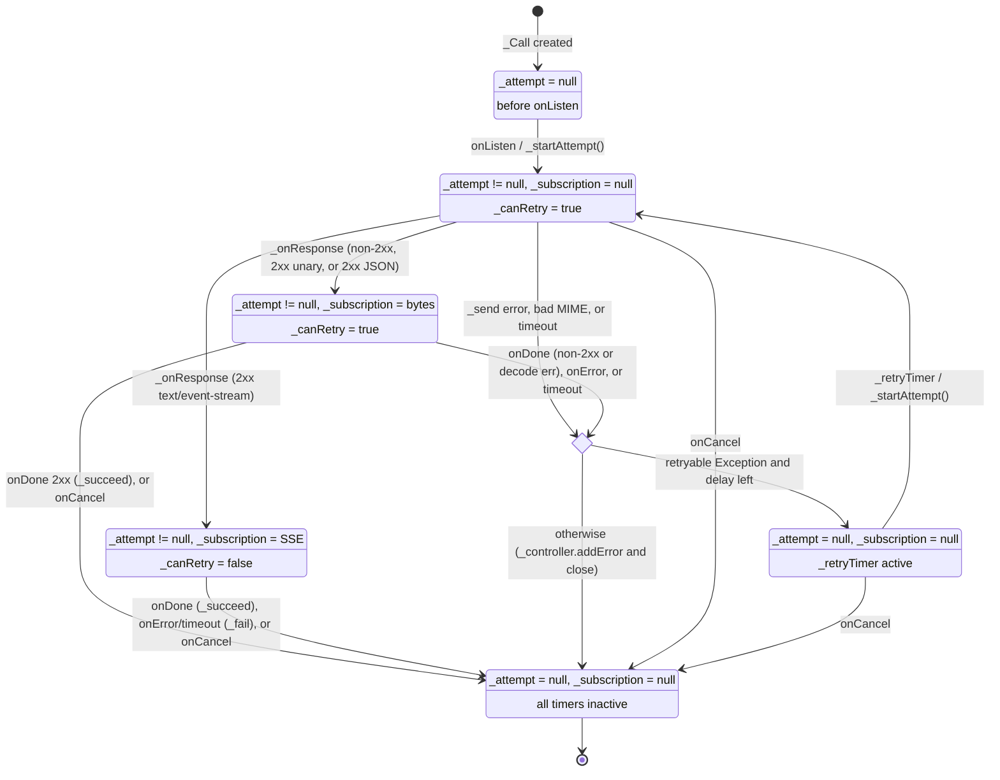

# `ServiceClient` State Machine (`_Call`)

This document describes the state machine implemented by
[`_Call`](lib/service_client.dart#L408-L702) in
[`lib/service_client.dart`](lib/service_client.dart). Both unary calls
([`_makeRequest`](lib/service_client.dart#L303-L319), which subscribes
immediately via `.messages.single`) and streaming calls
([`_makeStreamingRequest`](lib/service_client.dart#L325-L347), which returns
`.messages` for the caller to listen to) run on this same machine.

Every external callback — listener lifecycle hooks, `http.Client.send`
settlements, response stream events, and timers — is handled by a synchronous
method with no `await`, so `_Call`'s state cannot change mid-transition
([L404–L407](lib/service_client.dart#L404-L407)).

## Lifecycle Diagram

In-state events (`onData`, `onPause`, `onResume`, and stale callbacks from
abandoned attempts) do not change the lifecycle state and are detailed in the
matrix below.

## States and Field Predicates

Pause state (`_controller.isPaused`) is orthogonal to these six phases: pausing
stops `_stallTimer` and pauses `_subscription` (after one microtask), while
`_deadlineTimer` and `_retryTimer` continue running.
[`_hasResponse`](lib/service_client.dart#L462) is a purely computed getter
(`_subscription != null`), used only in the timer callbacks to select the
`TimeoutException` message.

| State | `_attempt` | `_canRetry` | `_subscription` | Active timers | Entered by |
|---|---|---|---|---|---|
| `WaitingForListen` | `null` | `true` | `null` | none | [`_Call`](lib/service_client.dart#L436) constructor |
| `Sending` | token | `true` | `null` | `_deadlineTimer`¹, `_stallTimer`² | [`_startAttempt`](lib/service_client.dart#L464) |
| `ReadingBody` | token | `true` | non-empty bytes | `_deadlineTimer`¹, `_stallTimer`² | [`_onResponse`](lib/service_client.dart#L511) → [`_readBody`](lib/service_client.dart#L566) |
| `StreamingSse` | token | `false` | decoded SSE maps | `_deadlineTimer`¹, `_stallTimer`² | [`_onResponse`](lib/service_client.dart#L545) → [`_listen`](lib/service_client.dart#L583) |
| `Backoff` | `null` | `true` | `null` | `_retryTimer` | [`_fail`](lib/service_client.dart#L664) |
| `Done` | `null` | last value | `null` | none | [`_succeed`](lib/service_client.dart#L650), [`_fail`](lib/service_client.dart#L666), [`_cancel`](lib/service_client.dart#L639) |

- ¹ Active when `_timeout != null`; counts paused time.
- ² Active when `_stallTimeout != null` and `!_controller.isPaused` (never used
  for unary calls, where `_stallTimeout` is `null`).

## Event × State Transition Matrix

Conventions:

- `—` means the event cannot occur in that state for the current attempt.
- **→ `Backoff` / `Done`** means [`_fail`](lib/service_client.dart#L658) runs
  [`_endAttempt`](lib/service_client.dart#L676), then enters `Backoff` (arms
  `_retryTimer` with `_delays.current`) if `_canRetry`, `error is Exception`,
  `_retry.isRetryable(error)`, and `_delays.moveNext()` all hold; otherwise it
  calls `_controller.addError` + `_controller.close` (`Done`).
- In `Sending`, entering `ReadingBody` or `StreamingSse` via
  [`_listen`](lib/service_client.dart#L583) immediately transitions on to
  `Backoff` or `Done` if the response stream terminates synchronously during
  `stream.listen(...)` ([L608–L611](lib/service_client.dart#L608-L611)).

| Event | `WaitingForListen` | `Sending` | `ReadingBody` | `StreamingSse` | `Backoff` | `Done` |
|---|---|---|---|---|---|---|
| `onListen` | **→ `Sending`** [`onListen`](lib/service_client.dart#L446) → [`_startAttempt`](lib/service_client.dart#L464): binds pause/resume/cancel, inits `_delays`, mints `_attempt`, starts timers, calls `_send`. | — | — | — | — | — |
| `_send` → non-2xx response (current) | — | **→ `ReadingBody`** [`_onResponse`](lib/service_client.dart#L511) ([L513–L522](lib/service_client.dart#L513-L522)): restarts stall timer, calls [`_readBody`](lib/service_client.dart#L566) (pauses sub if paused). | — | — | — | — |
| `_send` → 2xx unary or streaming `application/json` (current) | — | **→ `ReadingBody`** [`_onResponse`](lib/service_client.dart#L511) ([L523–L544](lib/service_client.dart#L523-L544)): restarts stall timer, calls [`_readBody`](lib/service_client.dart#L566) (pauses sub if paused). | — | — | — | — |
| `_send` → 2xx streaming `text/event-stream` (current) | — | **→ `StreamingSse`** [`_onResponse`](lib/service_client.dart#L511) ([L545–L554](lib/service_client.dart#L545-L554)): restarts stall timer, `_canRetry = false`, calls [`_listen`](lib/service_client.dart#L583) on [`_decodeEvents`](lib/service_client.dart#L367). | — | — | — | — |
| `_send` → 2xx streaming other/invalid MIME (current) | — | **→ `Backoff` / `Done`** [`_onResponse`](lib/service_client.dart#L555) cancels response ([`_cancelResponse`](lib/service_client.dart#L705)), throws `ServiceException`; `try`/`catch` ([L486–L490](lib/service_client.dart#L486-L490)) routes to [`_fail`](lib/service_client.dart#L658). | — | — | — | — |
| `_send` → error or sync throw (current) | — | **→ `Backoff` / `Done`** [`_startAttempt`](lib/service_client.dart#L497) calls [`_fail`](lib/service_client.dart#L658) (non-`Exception` `Error` always goes to `Done`). | — | — | — | — |
| Stream `onData` (current) | — | — | **Stay `ReadingBody`** [`_listen`](lib/service_client.dart#L590): appends non-empty chunk to `BytesBuilder` ([L573–L574](lib/service_client.dart#L573-L574)), calls [`_restartStallTimer`](lib/service_client.dart#L686). Empty chunks are filtered out. | **Stay `StreamingSse`** [`_listen`](lib/service_client.dart#L590): forwards decoded `'data: '` map to `_controller.add` ([L552](lib/service_client.dart#L552)), calls [`_restartStallTimer`](lib/service_client.dart#L686). Comments/partial lines do not fire `onData`. | — | — |
| Stream `onError` (current) | — | — | **→ `Backoff` / `Done`** [`_listen`](lib/service_client.dart#L595) calls [`_fail`](lib/service_client.dart#L658). | **→ `Done` (failed)** [`_listen`](lib/service_client.dart#L595) calls [`_fail`](lib/service_client.dart#L658) (transport or [`_decodeEvents`](lib/service_client.dart#L367) decode error; `_canRetry` is `false`). | — | — |
| Stream `onDone` (current) | — | — | **→ `Done` (succeeded) or `Backoff` / `Done`** [`_listen`](lib/service_client.dart#L598) clears `_subscription`, runs callback in `try`/`catch` ([L601–L605](lib/service_client.dart#L601-L605)): 2xx decodes UTF-8/JSON, adds message(s), calls [`_succeed`](lib/service_client.dart#L650); non-2xx ([L521](lib/service_client.dart#L521)) or decode failure throws to [`_fail`](lib/service_client.dart#L658). | **→ `Done` (succeeded)** [`_listen`](lib/service_client.dart#L598) clears `_subscription`, runs [`_succeed`](lib/service_client.dart#L650) in `try`/`catch` ([L601–L605](lib/service_client.dart#L601-L605)): calls `_endAttempt()` and `_controller.close()`. | — | — |
| `_deadlineTimer` fires (`timeout`) | — | **→ `Backoff` / `Done`** [`_startAttempt`](lib/service_client.dart#L470) → [`_timeOut`](lib/service_client.dart#L671) → [`_fail`](lib/service_client.dart#L658) (`"...did not return any data"`). | **→ `Backoff` / `Done`** [`_startAttempt`](lib/service_client.dart#L470) → [`_timeOut`](lib/service_client.dart#L671) → [`_fail`](lib/service_client.dart#L658) (`"...did not complete"`). | **→ `Done` (failed)** [`_startAttempt`](lib/service_client.dart#L470) → [`_timeOut`](lib/service_client.dart#L671) → [`_fail`](lib/service_client.dart#L658) (`"...did not complete"`, `_canRetry` is `false`). | — | — |
| `_stallTimer` fires (`streamWaitTimeout`) | — | **→ `Backoff` / `Done`** [`_restartStallTimer`](lib/service_client.dart#L694) → [`_timeOut`](lib/service_client.dart#L671) → [`_fail`](lib/service_client.dart#L658) (`"...did not return any data"`). Only fires while unpaused. | **→ `Backoff` / `Done`** [`_restartStallTimer`](lib/service_client.dart#L694) → [`_timeOut`](lib/service_client.dart#L671) → [`_fail`](lib/service_client.dart#L658) (`"No data received..."`). Only fires while unpaused. | **→ `Done` (failed)** [`_restartStallTimer`](lib/service_client.dart#L694) → [`_timeOut`](lib/service_client.dart#L671) → [`_fail`](lib/service_client.dart#L658) (`"No data received..."`, `_canRetry` is `false`). Only fires while unpaused. | — | — |
| `_retryTimer` fires | — | — | — | — | **→ `Sending`** [`_fail`](lib/service_client.dart#L664) → [`_startAttempt`](lib/service_client.dart#L464): mints `_attempt`, resets `_canRetry`, starts deadline timer (and stall timer if unpaused), calls `_send`. | — |
| `onPause` | — | **Stay `Sending`** [`_pause`](lib/service_client.dart#L618): cancels `_stallTimer`; deferred microtask is a no-op (`_subscription` is `null` or already paused by [`_listen`](lib/service_client.dart#L614)). `_deadlineTimer` keeps running. | **Stay `ReadingBody`** [`_pause`](lib/service_client.dart#L618): cancels `_stallTimer`; queues microtask ([L624](lib/service_client.dart#L624)) to pause `_subscription` if still active, unpaused, and controller paused. `_deadlineTimer` keeps running. | **Stay `StreamingSse`** [`_pause`](lib/service_client.dart#L618): cancels `_stallTimer`; queues microtask ([L624](lib/service_client.dart#L624)) to pause `_subscription` if still active, unpaused, and controller paused. `_deadlineTimer` keeps running. | **Stay `Backoff`** [`_pause`](lib/service_client.dart#L618): cancels inactive `_stallTimer`; microtask no-ops (`_subscription` is `null`). `_retryTimer` keeps running; future attempts honor `_controller.isPaused`. | — |
| `onResume` | — | **Stay `Sending`** [`_resume`](lib/service_client.dart#L634): `_subscription` is `null`; calls [`_restartStallTimer`](lib/service_client.dart#L686) to start fresh stall timer. | **Stay `ReadingBody`** [`_resume`](lib/service_client.dart#L634): calls `_subscription?.resume()` and [`_restartStallTimer`](lib/service_client.dart#L686). | **Stay `StreamingSse`** [`_resume`](lib/service_client.dart#L634): calls `_subscription?.resume()` and [`_restartStallTimer`](lib/service_client.dart#L686). | **Stay `Backoff`** [`_resume`](lib/service_client.dart#L634): no-op (`_subscription` is `null`, `_attempt` is `null`). | — |
| `onCancel` | — | **→ `Done` (cancelled)** [`_cancel`](lib/service_client.dart#L639): cancels timers, clears `_attempt` via `_endAttempt()`, returns `null`. | **→ `Done` (cancelled)** [`_cancel`](lib/service_client.dart#L639): detaches `_subscription`, calls `_endAttempt()`, returns `subscription.cancel()` (propagating cancel errors to caller). | **→ `Done` (cancelled)** [`_cancel`](lib/service_client.dart#L639): detaches `_subscription`, calls `_endAttempt()`, returns `subscription.cancel()` (propagating cancel errors to caller). | **→ `Done` (cancelled)** [`_cancel`](lib/service_client.dart#L639): cancels `_retryTimer`, calls `_endAttempt()`, returns `null`. | **Stay `Done`** If listener cancels before draining close/error, [`_cancel`](lib/service_client.dart#L639) is an idempotent no-op returning `null`. |
| Stale `_send` response (`!identical`) | — | **Stay `Sending`** [`_startAttempt`](lib/service_client.dart#L494): calls [`_cancelResponse`](lib/service_client.dart#L705) with `.ignoreExceptions()`. | **Stay `ReadingBody`** [`_startAttempt`](lib/service_client.dart#L494): calls [`_cancelResponse`](lib/service_client.dart#L705) with `.ignoreExceptions()`. | **Stay `StreamingSse`** [`_startAttempt`](lib/service_client.dart#L494): calls [`_cancelResponse`](lib/service_client.dart#L705) with `.ignoreExceptions()`. | **Stay `Backoff`** [`_startAttempt`](lib/service_client.dart#L494): calls [`_cancelResponse`](lib/service_client.dart#L705) with `.ignoreExceptions()`. | **Stay `Done`** [`_startAttempt`](lib/service_client.dart#L494): calls [`_cancelResponse`](lib/service_client.dart#L705) with `.ignoreExceptions()`. |
| Stale `_send` error (`!identical`) | — | **Stay `Sending`** [`_startAttempt`](lib/service_client.dart#L500): ignores `Exception`; rethrows `Error` uncaught ([L504](lib/service_client.dart#L504)). | **Stay `ReadingBody`** [`_startAttempt`](lib/service_client.dart#L500): ignores `Exception`; rethrows `Error` uncaught ([L504](lib/service_client.dart#L504)). | **Stay `StreamingSse`** [`_startAttempt`](lib/service_client.dart#L500): ignores `Exception`; rethrows `Error` uncaught ([L504](lib/service_client.dart#L504)). | **Stay `Backoff`** [`_startAttempt`](lib/service_client.dart#L500): ignores `Exception`; rethrows `Error` uncaught ([L504](lib/service_client.dart#L504)). | **Stay `Done`** [`_startAttempt`](lib/service_client.dart#L500): ignores `Exception`; rethrows `Error` uncaught ([L504](lib/service_client.dart#L504)). |
| Stale stream callback (`!identical`) | — | **Stay `Sending`** [`_listen`](lib/service_client.dart#L591)/[L596](lib/service_client.dart#L596)/[L599](lib/service_client.dart#L599): returns immediately. | **Stay `ReadingBody`** [`_listen`](lib/service_client.dart#L591)/[L596](lib/service_client.dart#L596)/[L599](lib/service_client.dart#L599): returns immediately. | **Stay `StreamingSse`** [`_listen`](lib/service_client.dart#L591)/[L596](lib/service_client.dart#L596)/[L599](lib/service_client.dart#L599): returns immediately. | **Stay `Backoff`** [`_listen`](lib/service_client.dart#L591)/[L596](lib/service_client.dart#L596)/[L599](lib/service_client.dart#L599): returns immediately. | **Stay `Done`** [`_listen`](lib/service_client.dart#L591)/[L596](lib/service_client.dart#L596)/[L599](lib/service_client.dart#L599): returns immediately. |

### Shared Transition Helpers

- [`_endAttempt`](lib/service_client.dart#L676-L682): clears `_attempt = null`,
  cancels `_deadlineTimer` and `_stallTimer`, cancels `_subscription` with
  [`ignoreExceptions`](lib/service_client.dart#L712-L716) (swallowing
  `Exception`s while letting `Error`s surface), and sets `_subscription = null`.
  By contrast, [`_cancel`](lib/service_client.dart#L639-L647) detaches
  `_subscription` first and returns `subscription?.cancel()` directly so
  explicit cancellation errors reach the caller.
- [`_restartStallTimer`](lib/service_client.dart#L686-L701): returns early if
  `_stallTimeout == null || _attempt == null || _controller.isPaused`;
  otherwise cancels any running `_stallTimer` and arms a fresh timer.

## Three Subtle Mechanisms in `_Call`

### 1. `_attempt` Identity Guard

Because `http.Client.send` cannot be aborted when an attempt times out or is
cancelled ([L479–L481](lib/service_client.dart#L479-L481)), an abandoned
attempt's `_send` future or response stream may still deliver callbacks later,
including after a retry has already started a *new* attempt.

[`_startAttempt`](lib/service_client.dart#L465) therefore assigns a fresh
`Object()` token (`final attempt = _attempt = Object()`) and captures `attempt`
in both the `_send` callbacks ([L485](lib/service_client.dart#L485),
[L498](lib/service_client.dart#L498)) and
[`_listen`](lib/service_client.dart#L588) (`identical(attempt, _attempt)`).
[`_endAttempt`](lib/service_client.dart#L677) sets `_attempt = null`. Using
object identity instead of a boolean ensures a late callback from attempt 1
cannot interfere with attempt 2:

- A late `_send` response is drained immediately via
  `_cancelResponse(response).ignoreExceptions()`
  ([L494](lib/service_client.dart#L494)) to release the HTTP connection.
- A late `_send` `Exception` is ignored, while a non-`Exception` `Error` is
  rethrown uncaught via `Error.throwWithStackTrace`
  ([L500–L505](lib/service_client.dart#L500-L505)) so programming bugs are not
  hidden.
- Late stream callbacks check `identical(attempt, _attempt)` and return without
  mutating state ([L591](lib/service_client.dart#L591),
  [L596](lib/service_client.dart#L596), [L599](lib/service_client.dart#L599)).

### 2. Sync-Done Check in `_listen`

In [`_listen`](lib/service_client.dart#L583-L616), `stream.listen(...)` runs
*before* `_subscription` is assigned
([L589–L613](lib/service_client.dart#L589-L613)). If `stream` delivers
`onDone` or `onError` synchronously inside `listen()`, the callback runs
[`_succeed`](lib/service_client.dart#L650) or
[`_fail`](lib/service_client.dart#L658) →
[`_endAttempt`](lib/service_client.dart#L676), clearing `_attempt` before
`stream.listen(...)` returns.

Checking `if (!identical(attempt, _attempt))` right after `stream.listen(...)`
([L608–L615](lib/service_client.dart#L608-L615)) catches that case: `_listen`
cancels the returned subscription (`.ignoreExceptions()`) instead of storing a
dead subscription on an already-ended attempt. Otherwise it saves
`_subscription` and immediately pauses it if `_controller.isPaused` is already
`true` ([L614](lib/service_client.dart#L614)) — for example, when headers
arrive while the caller is paused.

### 3. One-Microtask Deferred `_pause`

When the caller pauses the stream, [`_pause`](lib/service_client.dart#L618-L632)
cancels `_stallTimer` immediately ([L619](lib/service_client.dart#L619)) so
paused time never counts against `streamWaitTimeout`, but defers
`subscription.pause()` by one microtask via `scheduleMicrotask`
([L624–L631](lib/service_client.dart#L624-L631)).

This avoids a false `timeout` on an already-finished stream: if the listener
calls `pause()` inside `onData` on the final SSE event while the upstream
`onDone` is already queued behind it, pausing synchronously would hold `onDone`
back and leave `_deadlineTimer` ticking while paused. Deferring by one
microtask lets `onDone` run first, call
[`_succeed`](lib/service_client.dart#L650), and cancel `_deadlineTimer`.

When the microtask executes, three guards
([L626–L628](lib/service_client.dart#L626-L628)) handle intervening events:

- `subscription != null`: skips if the attempt ended (`_succeed`, `_fail`, or
  `_cancel`) before the microtask ran.
- `!subscription.isPaused`: avoids double-pausing (Dart's
  `StreamSubscription.pause` is reference-counted) if `_listen`
  ([L614](lib/service_client.dart#L614)) or an earlier pause microtask already
  paused it.
- `_controller.isPaused`: skips if [`_resume`](lib/service_client.dart#L634)
  ran before the microtask fired.
