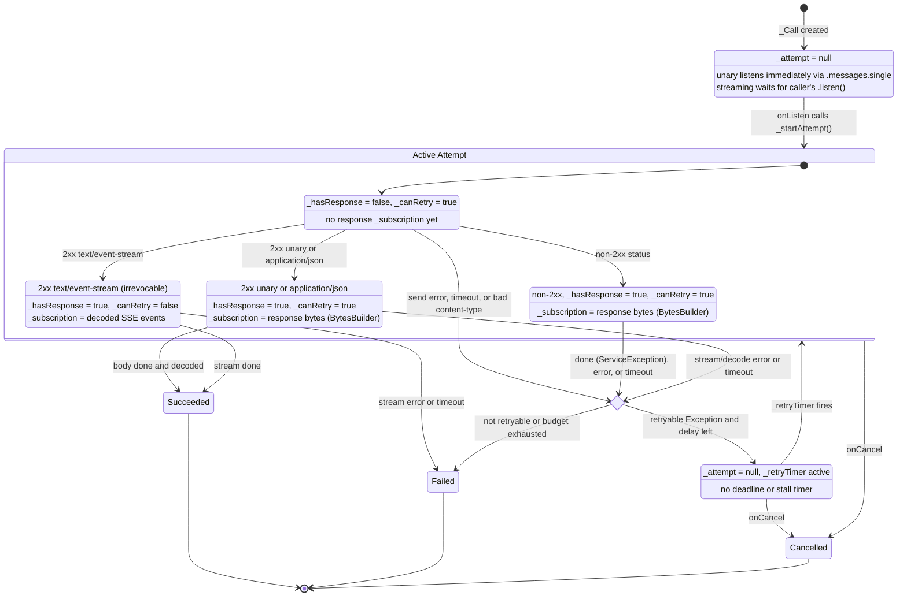
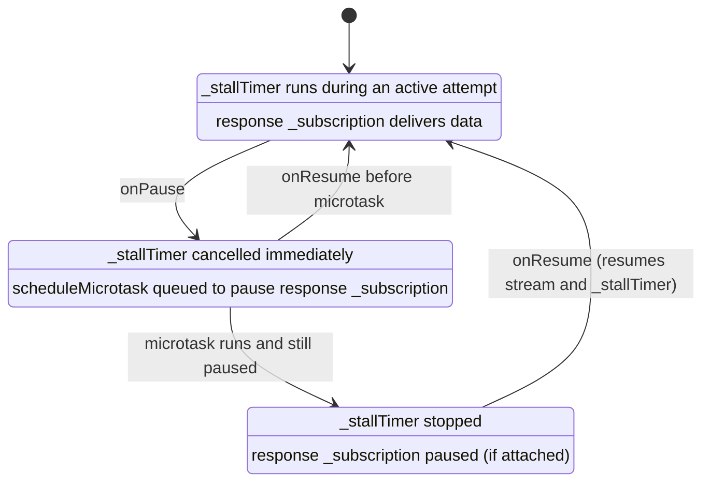

# `ServiceClient` State Machine

This document describes the callback-driven state machine (`_Call`) in
[`lib/service_client.dart`](lib/service_client.dart), which executes both unary
and streaming RPCs with retries, `timeout`, `streamWaitTimeout`, pause/resume,
and cancellation.

## Core Design

Every external event — listener lifecycle callbacks (`onListen`, `onPause`,
`onResume`, `onCancel`), `http.Client.send` completions, response stream events,
and timers — is handled by a synchronous method on `_Call`. Because no method
uses `await`, the state of a call cannot change mid-transition.

Each attempt mints a fresh token (`_attempt = Object()`). When an attempt ends
(`_endAttempt`), `_attempt` is cleared to `null`, so any late callback from an
abandoned attempt detects `!identical(attempt, _attempt)` and cleans up instead
of mutating the active state.

## Call Lifecycle

Notes on transitions inside `ActiveAttempt`:

- **Stall-timer resets**: Every non-empty byte chunk in `ReadingErrorBody` or
  `ReadingBufferedBody`, and every decoded SSE `data:` event in
  `StreamingEvents`, resets `_stallTimer` (when unpaused). Empty chunks, SSE
  comments, and partial SSE lines do not reset it.
- **Unsupported content type**: In `AwaitingHeaders`, a 2xx streaming response
  with a MIME type other than `application/json` or `text/event-stream` cancels
  the response (`_cancelResponse`) and throws a `ServiceException`, routing to
  `RetryCheck`.
- **Synchronous-done streams**: If `stream.listen(...)` in `_listen` completes
  or errors synchronously before returning, `isOver()` is already `true` when
  `listen` returns, so `_listen` cancels the returned subscription and skips
  storing `_subscription`.

## Pause, Resume, and Timers

Pause state is tracked by `_controller.isPaused` and is orthogonal to the
attempt lifecycle:

- `_deadlineTimer` (`timeout`) runs continuously across an entire active attempt
  and **counts paused time**. It never runs during `WaitingToRetry`.
- `_stallTimer` (`streamWaitTimeout`) runs during an active attempt only while
  **unpaused**. It is not used for unary calls (`_stallTimeout == null`).

Why `_pause` defers `_subscription.pause()` by one microtask: if the listener
pauses inside `onData` on the final SSE event of a response whose `onDone` is
already queued behind it, deferring the upstream pause lets `onDone` run first
and call `_succeed()`, cancelling `_deadlineTimer` so the already-finished
response cannot time out while the listener is paused. If a new `_subscription`
is attached while already paused (for example, headers arrive while paused),
`_listen` pauses it immediately.

## State Invariants

| State | `_attempt` | `_hasResponse` | `_canRetry` | `_subscription` | Active timers |
|---|---|---|---|---|---|
| `Idle` | `null` | `false` | `true` | `null` | none |
| `AwaitingHeaders` | token | `false` | `true` | `null` | deadline, stall* |
| `ReadingErrorBody` | token | `true` | `true` | response bytes | deadline, stall* |
| `ReadingBufferedBody` | token | `true` | `true` | response bytes | deadline, stall* |
| `StreamingEvents` | token | `true` | `false` | SSE events | deadline, stall* |
| `WaitingToRetry` | `null` | — | `true` | `null` | retry |
| `Succeeded` / `Failed` / `Cancelled` | `null` | — | — | `null` | none |

\* `_stallTimer` is active only when `_stallTimeout != null` and
`!_controller.isPaused`.

## Stale Callbacks, Cancellation, and Timeout Messages

- **Late `_send` completions**: Because `_send` is not aborted when an attempt
  times out or is cancelled, its `Future` may settle after `_attempt` has
  changed (`!identical(attempt, _attempt)`):
  - Late `StreamedResponse`: cancelled immediately via
    `_cancelResponse(response).ignoreExceptions()` to release the connection.
  - Late `Exception`: ignored (nobody is waiting for it).
  - Late `Error`: rethrown uncaught via `Error.throwWithStackTrace`.
- **Explicit vs. internal cancellation**:
  - Caller `subscription.cancel()` (`_cancel`) cancels `_retryTimer`, detaches
    `_subscription`, calls `_endAttempt()`, and **returns
    `subscription?.cancel()`** so cancel errors propagate to the caller.
  - Internal cleanup (`_endAttempt`, used on timeout, stream error, and
    `_succeed`) calls `_subscription?.cancel().ignoreExceptions()`, swallowing
    `Exception`s while letting `Error`s surface.
- **Timeout messages**:
  - While `_hasResponse == false`, both `_deadlineTimer` and `_stallTimer` fail
    with `'Request to $_url did not return any data'`.
  - Once `_hasResponse == true`, `_deadlineTimer` fails with
    `'Request to $_url did not complete'` and `_stallTimer` fails with
    `'No data received from $_url'`.
