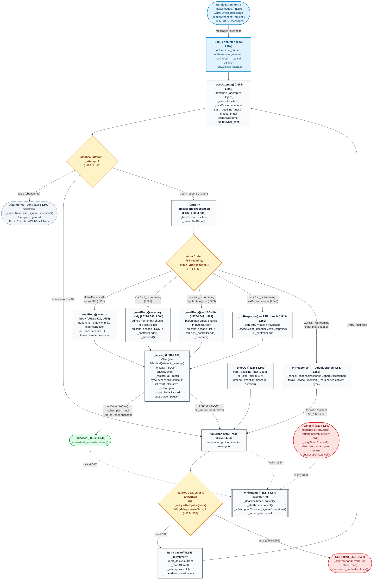
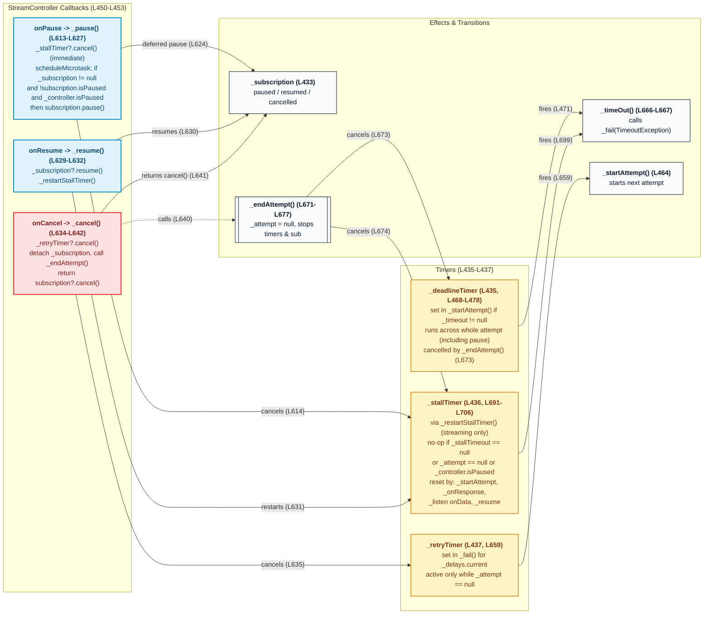

# `ServiceClient` / `_Call` Execution Flow

This document maps the callback-driven state machine in
[`_Call`](lib/service_client.dart#L408-L707)
([`lib/service_client.dart`](lib/service_client.dart)) directly to its Dart
methods, field mutations, and line numbers.

Every external event — stream listener callbacks, `http.Client.send`
settlements, response stream events, and timers — runs synchronously without
`await`, so call state cannot change mid-method. Each attempt mints a fresh
token (`_attempt = Object()`) so late callbacks from an abandoned attempt can
detect `!identical(attempt, _attempt)` and clean up without touching the active
attempt.

## Call Lifecycle (Method-Centric Flowchart)

Node colors denote **Entry** (blue), **Active Method** (slate),
**Decision / Branch** (amber), **Terminal Success** (green), **Terminal Error /
Cancel** (red), and **Abandoned Cleanup** (dashed gray). Solid arrows show
control flow; dashed arrows show shared helper calls to `_endAttempt()`.

### Notable Edge Cases in the Lifecycle

- **Synchronous `_send` throws** ([L484](lib/service_client.dart#L484)):
  `Future.sync(_send)` converts synchronous exceptions — such as lazy
  `body?._asEncodedJson` encoding in `_makeStreamingRequest`
  ([L338](lib/service_client.dart#L338)) — into the Future's `onError` handler
  and routes them to `_fail()`.
- **Synchronous stream completion in `_listen()`**
  ([L603–L610](lib/service_client.dart#L603-L610)): if `stream.listen(...)`
  fires `onDone` or `onError` synchronously before returning, `_endAttempt()`
  has already cleared `_attempt = null`, so `isOver()` is `true`; `_listen()`
  cancels the returned subscription and never stores it in `_subscription`.
- **Empty unary 2xx body** ([L525–L527](lib/service_client.dart#L525-L527)):
  `responseBody.isEmpty` emits `{}` rather than calling `jsonDecode('')`.
- **Retryability of `application/json` vs. `text/event-stream`**
  ([L533–L552](lib/service_client.dart#L533-L552)): a streaming call that
  receives `application/json` keeps `_canRetry = true` while buffering the full
  JSON list; a `text/event-stream` response sets `_canRetry = false` before
  listening, so any subsequent error or timeout is terminal even before the
  first event arrives.

## Orthogonal Callbacks & Timer Wiring

Pause/resume, caller cancellation, and all three timers operate independently
of which response branch `_Call` is in. Pause state lives on
`_controller.isPaused`: `_deadlineTimer` counts paused time, while
`_stallTimer` does not.

### Callback & Timer Details

- **Deferred upstream pause** ([L615–L626](lib/service_client.dart#L615-L626)):
  `_pause()` cancels `_stallTimer` immediately but defers
  `subscription.pause()` by one microtask. If the listener pauses inside
  `onData` on the final SSE event and `onDone` is already queued behind it,
  `onDone -> _succeed()` runs first and cancels `_deadlineTimer`, preventing
  an already-finished response from timing out while paused. If headers arrive
  while already paused, `_listen()` pauses the new subscription immediately
  ([L609](lib/service_client.dart#L609)).
- **Stall-timer resets**: `_restartStallTimer()` resets `_stallTimer` on
  `_startAttempt()` ([L479](lib/service_client.dart#L479)), `_onResponse()`
  ([L510](lib/service_client.dart#L510)), `_resume()`
  ([L631](lib/service_client.dart#L631)), and every `_listen()` data event
  ([L592](lib/service_client.dart#L592)) — meaning every non-empty byte chunk
  (filtered in `_readBody`, [L571](lib/service_client.dart#L571)) or every
  decoded SSE `data: ` event (filtered in `_decodeEvents`,
  [L377](lib/service_client.dart#L377)). Empty chunks, SSE comments, and partial
  SSE lines do not reset it.
- **Explicit vs. internal cancellation**: caller cancellation via `_cancel()`
  ([L638–L641](lib/service_client.dart#L638-L641)) detaches `_subscription`
  before calling `_endAttempt()` and returns `subscription?.cancel()` directly
  so cancellation errors reach the caller. Internal cleanup (`_endAttempt` at
  [L675](lib/service_client.dart#L675) and `_cancelResponse` at
  [L491](lib/service_client.dart#L491), [L554](lib/service_client.dart#L554))
  calls `.ignoreExceptions()` ([L718–L720](lib/service_client.dart#L718-L720)),
  which swallows `Exception`s while letting `Error`s propagate uncaught.

### Timeout Messages

| Timer | `_hasResponse == false` | `_hasResponse == true` | Lines |
|---|---|---|---|
| `_deadlineTimer` | `'Request to $_url did not return any data'` | `'Request to $_url did not complete'` | [L471–L476](lib/service_client.dart#L471-L476) |
| `_stallTimer` | `'Request to $_url did not return any data'` | `'No data received from $_url'` | [L699–L704](lib/service_client.dart#L699-L704) |

## `_Call` Mutable Fields

| Field | Declared | Set / Updated By | Cleared / Cancelled By |
|---|---|---|---|
| `_delays` | [L421](lib/service_client.dart#L421) | `onListen` ([L454](lib/service_client.dart#L454)); advanced by `_fail` ([L658](lib/service_client.dart#L658)) | — |
| `_attempt` | [L424](lib/service_client.dart#L424) | `_startAttempt` (`Object()`, [L465](lib/service_client.dart#L465)) | `_endAttempt` (`null`, [L672](lib/service_client.dart#L672)) |
| `_canRetry` | [L427](lib/service_client.dart#L427) | `_startAttempt` (`true`, [L466](lib/service_client.dart#L466)); `_onResponse` SSE (`false`, [L547](lib/service_client.dart#L547)) | reset on next `_startAttempt` |
| `_hasResponse` | [L430](lib/service_client.dart#L430) | `_startAttempt` (`false`, [L467](lib/service_client.dart#L467)); `_onResponse` (`true`, [L509](lib/service_client.dart#L509)) | reset on next `_startAttempt` |
| `_subscription` | [L433](lib/service_client.dart#L433) | `_listen` ([L608](lib/service_client.dart#L608)) | `_listen` `onDone` ([L599](lib/service_client.dart#L599)), `_cancel` ([L639](lib/service_client.dart#L639)), `_endAttempt` ([L676](lib/service_client.dart#L676)) |
| `_deadlineTimer` | [L435](lib/service_client.dart#L435) | `_startAttempt` ([L469](lib/service_client.dart#L469)) | `_endAttempt` ([L673](lib/service_client.dart#L673)) |
| `_stallTimer` | [L436](lib/service_client.dart#L436) | `_restartStallTimer` ([L697](lib/service_client.dart#L697)) | `_pause` ([L614](lib/service_client.dart#L614)), `_endAttempt` ([L674](lib/service_client.dart#L674)), `_restartStallTimer` ([L696](lib/service_client.dart#L696)) |
| `_retryTimer` | [L437](lib/service_client.dart#L437) | `_fail` ([L659](lib/service_client.dart#L659)) | `_cancel` ([L635](lib/service_client.dart#L635)) |

## Method Index

### `ServiceClient` Entry & Parsing Helpers

| Symbol | Lines | Role |
|---|---|---|
| [`ServiceClient._send`](lib/service_client.dart#L284-L301) | L284–L301 | Builds a fresh `http.Request` with headers/body and calls `client.send(request)`. |
| [`ServiceClient._makeRequest`](lib/service_client.dart#L303-L319) | L303–L319 | Validates `timeout`, eagerly JSON-encodes `body`, returns `_Call(..., isStreaming: false).messages.single`. |
| [`ServiceClient._makeStreamingRequest`](lib/service_client.dart#L325-L347) | L325–L347 | Validates timeouts, optionally adds `alt=sse`, lazily encodes `body`, returns `_Call(..., isStreaming: true).messages`. |
| [`ServiceClient._mimeType`](lib/service_client.dart#L351-L359) | L351–L359 | Parses response `content-type` MIME type, or `null` if missing/malformed. |
| [`ServiceClient._checkTimeout`](lib/service_client.dart#L361-L365) | L361–L365 | Throws `ArgumentError` if a non-null timeout is `<= Duration.zero`. |
| [`ServiceClient._decodeEvents`](lib/service_client.dart#L367-L383) | L367–L383 | Decodes UTF-8 SSE stream lines prefixed with `'data: '` into `Map<String, dynamic>`. |
| [`ServiceClient._makeUrlStreaming`](lib/service_client.dart#L385-L389) | L385–L389 | Returns `url` with query parameter `alt=sse`. |

### `_Call` Methods

| Method | Lines | Role & Key Mutations |
|---|---|---|
| [`_Call()` / `onListen`](lib/service_client.dart#L439-L457) | L439–L457 | Wires `onPause`, `onResume`, `onCancel`; initializes `_delays`; calls `_startAttempt()`. |
| [`messages`](lib/service_client.dart#L462) | L462 | Exposes `_controller.stream` to callers. |
| [`_startAttempt`](lib/service_client.dart#L464-L506) | L464–L506 | Mints `_attempt = Object()`, resets `_canRetry = true` and `_hasResponse = false`, starts `_deadlineTimer` and `_stallTimer`, invokes `Future.sync(_send)`, and guards late settlements. |
| [`_onResponse`](lib/service_client.dart#L508-L561) | L508–L561 | Sets `_hasResponse = true`, resets stall timer, and dispatches non-2xx, unary 2xx, streaming `application/json`, streaming `text/event-stream` (`_canRetry = false`), or unsupported MIME error. |
| [`_readBody`](lib/service_client.dart#L564-L575) | L564–L575 | Filters out empty byte chunks, accumulates them in `BytesBuilder`, and passes bytes to `onDone` via `_listen()`. |
| [`_listen`](lib/service_client.dart#L581-L611) | L581–L611 | Attaches `stream.listen` with `isOver()` guard; restarts stall timer on data; handles synchronous completion; stores `_subscription` (pausing if `_controller.isPaused`). |
| [`_pause`](lib/service_client.dart#L613-L627) | L613–L627 | Cancels `_stallTimer` immediately; schedules microtask to pause `_subscription` if still paused. |
| [`_resume`](lib/service_client.dart#L629-L632) | L629–L632 | Resumes `_subscription` and calls `_restartStallTimer()`. |
| [`_cancel`](lib/service_client.dart#L634-L642) | L634–L642 | Cancels `_retryTimer`, detaches `_subscription`, calls `_endAttempt()`, and returns `subscription?.cancel()`. |
| [`_succeed`](lib/service_client.dart#L645-L648) | L645–L648 | Calls `_endAttempt()` and closes `_controller`. |
| [`_fail`](lib/service_client.dart#L653-L664) | L653–L664 | Calls `_endAttempt()`; schedules `_retryTimer` if retryable with remaining delay, otherwise emits error and closes `_controller`. |
| [`_timeOut`](lib/service_client.dart#L666-L667) | L666–L667 | Routes a `TimeoutException(message, duration)` into `_fail()`. |
| [`_endAttempt`](lib/service_client.dart#L671-L677) | L671–L677 | Clears `_attempt = null`, cancels `_deadlineTimer` and `_stallTimer`, cancels `_subscription` via `.ignoreExceptions()`, and clears `_subscription = null`. |
| [`_run`](lib/service_client.dart#L681-L687) | L681–L687 | Runs a synchronous callback and routes any thrown error to `_fail()`. |
| [`_restartStallTimer`](lib/service_client.dart#L691-L706) | L691–L706 | Cancels and restarts `_stallTimer` when `_stallTimeout != null`, `_attempt != null`, and `!_controller.isPaused`. |

### File-Private Helpers

| Symbol | Lines | Role |
|---|---|---|
| [`_cancelResponse`](lib/service_client.dart#L710-L711) | L710–L711 | Listens and immediately cancels `response.stream` to release the HTTP connection. |
| [`_asEncodedJson`](lib/service_client.dart#L713-L715) | L713–L715 | Extension getter on `JsonEncodable` returning `jsonEncode(toJson())`. |
| [`ignoreExceptions`](lib/service_client.dart#L717-L721) | L717–L721 | Extension on `Future<void>` swallowing `Exception`s while letting `Error`s surface uncaught. |
