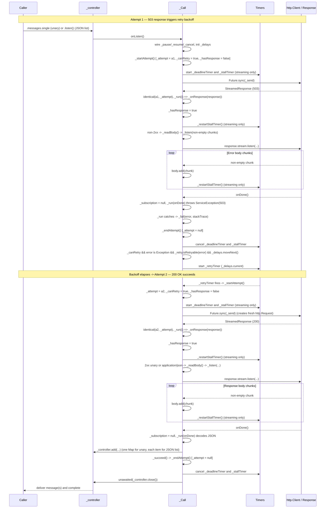
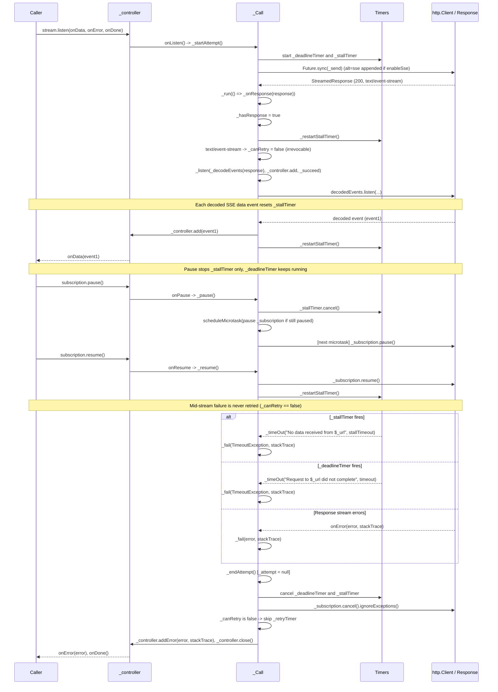
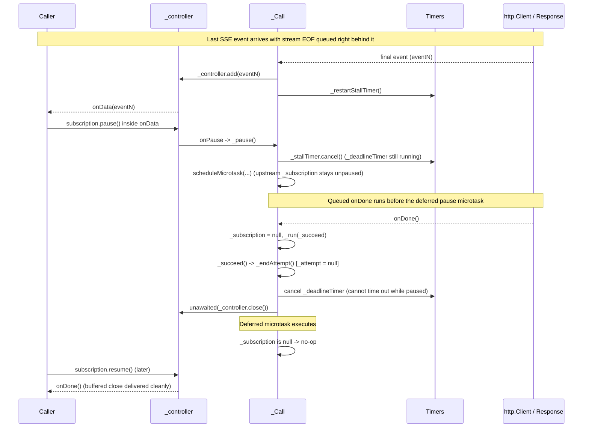
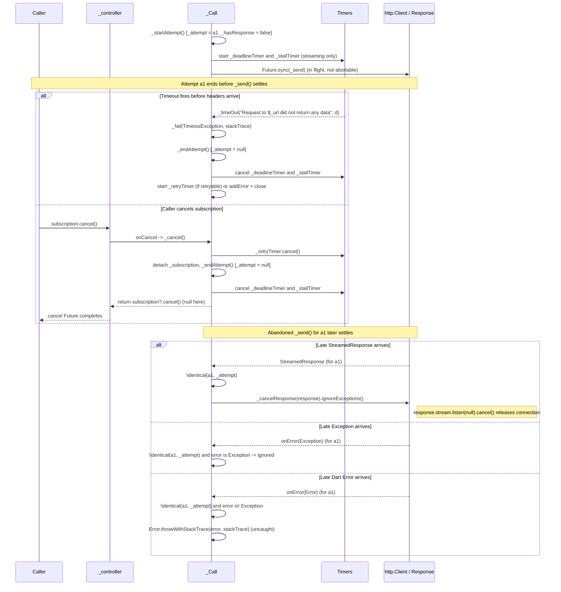

# `ServiceClient` Call Flows (`_Call`)

This document traces the runtime behavior of
[`_Call`](lib/service_client.dart#L408-L707) in
[`lib/service_client.dart`](lib/service_client.dart) using concrete sequence
diagrams and a 1-to-1 method lookup table.

## How `_Call` Works in Two Rules

1. **No `await` inside `_Call`**: Every external event (`StreamController`
   callbacks, `http.Client.send` completions, response stream events, and
   timers) runs synchronously to completion. State cannot mutate mid-callback.
2. **Per-attempt identity token (`_attempt`)**:
   [`_startAttempt`](lib/service_client.dart#L464-L506) mints a fresh
   `Object()` in [`_attempt`](lib/service_client.dart#L424). Ending an attempt
   via [`_endAttempt`](lib/service_client.dart#L671-L677) clears `_attempt` to
   `null`. Any late callback from an abandoned attempt sees
   `!identical(attempt, _attempt)` and cleans up instead of mutating live state.

All diagrams below use the same five participants:

- **`Caller`**: User code awaiting the unary `Future` or listening to the
  returned `Stream`.
- **`_controller`**: [`_Call._controller`](lib/service_client.dart#L418), the
  single-subscription `StreamController<Map<String, dynamic>>`.
- **`_Call`**: The [`_Call`](lib/service_client.dart#L408-L707) instance.
- **`Timers`**: [`_deadlineTimer`](lib/service_client.dart#L435) (`timeout`),
  [`_stallTimer`](lib/service_client.dart#L436) (`streamWaitTimeout`), and
  [`_retryTimer`](lib/service_client.dart#L437).
- **`http.Client / Response`**:
  [`ServiceClient._send`](lib/service_client.dart#L284-L301) and the returned
  `http.StreamedResponse` byte or SSE stream.

---

## Scenario 1: Buffered Request — Retryable 503 Failure and 200 Success

Both unary calls ([`_makeRequest`](lib/service_client.dart#L303-L319)) and
streaming calls that receive `application/json`
([`_makeStreamingRequest`](lib/service_client.dart#L325-L347)) buffer the full
response body via [`_readBody`](lib/service_client.dart#L564-L575) before
delivering messages. Because nothing reaches the caller until the body finishes,
[`_canRetry`](lib/service_client.dart#L427) stays `true` throughout.

Key details in this flow:

- **Error body decoding**: Invalid UTF-8 in a non-2xx body is tolerated
  (`responseBody` becomes `null` at
  [`lib/service_client.dart#L513-L519`](lib/service_client.dart#L513-L519)).
- **Empty chunks**: [`_readBody`](lib/service_client.dart#L564-L575) filters out
  empty chunks (`chunk.isNotEmpty`) so they cannot falsely reset `_stallTimer`.
- **No timers during backoff**: `_endAttempt()` cancels `_deadlineTimer` and
  `_stallTimer` before `_retryTimer` starts.
- **Unsupported 2xx streaming MIME type**: If `_isStreaming` is `true` and the
  2xx `content-type` is neither `application/json` nor `text/event-stream`,
  [`_onResponse`](lib/service_client.dart#L553-L558) calls
  `_cancelResponse(response).ignoreExceptions()` and throws a
  `ServiceException`, which `_run` routes to `_fail`.

---

## Scenario 2: SSE Streaming — Events, Pause/Resume, and Failure

When a streaming call receives `200 text/event-stream`,
[`_onResponse`](lib/service_client.dart#L543-L552) sets
[`_canRetry = false`](lib/service_client.dart#L547) immediately because events
are forwarded to the caller as they arrive. Any later error or timeout fails the
stream without retrying.

Key details in this flow:

- **What resets `_stallTimer`**: Only decoded `data: ` lines from
  [`_decodeEvents`](lib/service_client.dart#L367-L383) invoke `_listen`'s
  `onData` and reset `_stallTimer`. SSE comments, blank lines, and partial lines
  do not reset it.
- **Already paused when headers arrive**: If `_controller.isPaused` is already
  `true` when `_listen` subscribes, [`_listen`](lib/service_client.dart#L609)
  pauses `subscription` immediately and
  [`_restartStallTimer`](lib/service_client.dart#L693) is a no-op.

---

## Scenario 3: Deferred Pause Microtask — Why `onDone` Beats `_deadlineTimer`

[`_pause`](lib/service_client.dart#L613-L627) cancels `_stallTimer`
immediately, but defers `_subscription.pause()` by one microtask via
`scheduleMicrotask`. This closes a subtle race when a caller pauses inside
`onData` on the final event of an already-finishing stream:

If `_pause()` paused `_subscription` synchronously instead, the queued `onDone`
would be held back until `resume()`, leaving `_deadlineTimer` running on an
already-completed response. Similarly, if the caller calls `resume()` before the
deferred microtask runs, `_controller.isPaused` is `false` when the microtask
checks it at [`lib/service_client.dart#L623`](lib/service_client.dart#L623), so
the pause is skipped.

---

## Scenario 4: Timeout or `cancel()` While `_send()` Is In Flight

Because `http.Client.send` is not currently aborted (see TODO at
[`lib/service_client.dart#L480-L482`](lib/service_client.dart#L480-L482)), a
request can time out or be cancelled before `_send()` resolves. The `_attempt`
token ensures the abandoned `Future` cannot interfere with a retry or closed
call, and still releases the HTTP connection if a late response arrives.

Three important subtleties in abandonment and cancellation:

- **Retry already started**: Even if `_retryTimer` fires and starts attempt `a2`
  before `a1`'s `_send()` settles, `identical(a1, _attempt)` is still `false`
  because each `_startAttempt()` allocates a distinct `Object()`.
- **Caller `cancel()` vs. internal cleanup**:
  [`_cancel`](lib/service_client.dart#L634-L642) detaches `_subscription` before
  calling `_endAttempt()` and **returns `subscription?.cancel()`**, propagating
  any cancel error to the caller. By contrast,
  [`_endAttempt`](lib/service_client.dart#L671-L677) calls
  `_subscription?.cancel().ignoreExceptions()`, swallowing `Exception`s while
  allowing Dart `Error`s to surface uncaught.
- **Synchronous stream completion**:
  [`_listen`](lib/service_client.dart#L586-L606) uses the same `attempt` token
  via `isOver()`. If `stream.listen(...)` triggers `onDone` or `onError`
  synchronously before returning, `isOver()` is already `true` when `listen`
  returns, so `_listen` cancels the returned subscription immediately instead of
  storing it in `_subscription`.

---

## Unary vs. Streaming Comparison

| Behavior | Unary ([`_makeRequest`](lib/service_client.dart#L303-L319)) | Streaming JSON list ([`_makeStreamingRequest`](lib/service_client.dart#L325-L347)) | Streaming SSE ([`_makeStreamingRequest`](lib/service_client.dart#L325-L347)) |
|---|---|---|---|
| Public return | `Future<Map<String, dynamic>>` via `.messages.single` | `Stream<Map<String, dynamic>>` via `.messages` | `Stream<Map<String, dynamic>>` via `.messages` |
| Start & body encoding | Starts immediately; body JSON-encoded eagerly ([L311](lib/service_client.dart#L311)) | Starts on `.listen()`; body JSON-encoded lazily ([L338](lib/service_client.dart#L338)) | Starts on `.listen()`; body JSON-encoded lazily ([L338](lib/service_client.dart#L338)) |
| Query parameter | Unchanged | Unchanged unless `enableSse: true` (`alt=sse`) | `alt=sse` when `enableSse: true` ([L336](lib/service_client.dart#L336)) |
| 2xx response parsing | [`_readBody`](lib/service_client.dart#L564-L575) -> single JSON object (or `{}` if empty) | [`_readBody`](lib/service_client.dart#L564-L575) -> JSON `List`, emits each element | [`_decodeEvents`](lib/service_client.dart#L367-L383) -> emits each `data: ` JSON event live |
| Retry after 2xx headers | Yes (`_canRetry == true` while reading body) | Yes (`_canRetry == true` while reading body) | **No** (`_canRetry = false` at [L547](lib/service_client.dart#L547)) |
| `_deadlineTimer` (`timeout`) | Per attempt; counts paused time | Per attempt; counts paused time | Per attempt; counts paused time |
| `_stallTimer` (`streamWaitTimeout`) | Unused (`_stallTimeout == null`) | Active while unpaused; reset on headers, non-empty chunks, `_resume` | Active while unpaused; reset on headers, `data: ` events, `_resume` |
| Timeout message before headers (`_hasResponse == false`) | `'Request to $_url did not return any data'` | `'Request to $_url did not return any data'` (both timers) | `'Request to $_url did not return any data'` (both timers) |
| Timeout message after headers (`_hasResponse == true`) | `'Request to $_url did not complete'` | Deadline: `'...did not complete'`; stall: `'No data received from $_url'` | Deadline: `'...did not complete'`; stall: `'No data received from $_url'` |

---

## `_Call` State Fields & Method Lookup Table

### Mutable State Fields

| Field | Location | Role |
|---|---|---|
| `_delays` | [L421](lib/service_client.dart#L421) | `Iterator<Duration>` from `_retry.delays().iterator`, initialized once in `onListen`. |
| `_attempt` | [L424](lib/service_client.dart#L424) | Unique `Object()` token for the active attempt, or `null` when idle, waiting to retry, or finished. |
| `_canRetry` | [L427](lib/service_client.dart#L427) | Reset to `true` per attempt; flipped to `false` only on `2xx text/event-stream`. |
| `_hasResponse` | [L430](lib/service_client.dart#L430) | Reset to `false` per attempt; set to `true` in `_onResponse`. Selects timeout message wording. |
| `_subscription` | [L433](lib/service_client.dart#L433) | Active `StreamSubscription` for response bytes (`_readBody`) or decoded SSE events (`_decodeEvents`). |
| `_deadlineTimer` | [L435](lib/service_client.dart#L435) | Per-attempt `timeout` timer. Runs continuously (including while paused); cancelled in `_endAttempt`. |
| `_stallTimer` | [L436](lib/service_client.dart#L436) | Per-attempt `streamWaitTimeout` timer. Runs only while unpaused; cancelled in `_pause` and `_endAttempt`. |
| `_retryTimer` | [L437](lib/service_client.dart#L437) | Backoff timer between failed attempt and next `_startAttempt`. Cancelled in `_cancel`. |

### `_Call` Methods

| Method | Lines | Called By | Behavior |
|---|---|---|---|
| [`_Call(...)`](lib/service_client.dart#L439-L457) | L439–L457 | `_makeRequest`, `_makeStreamingRequest` | Stores config and sets `_controller.onListen` to bind `_pause`/`_resume`/`_cancel`, initialize `_delays`, and call `_startAttempt()`. |
| [`messages`](lib/service_client.dart#L462) | L462 | `_makeRequest`, `_makeStreamingRequest` | Exposes `_controller.stream`. |
| [`_startAttempt`](lib/service_client.dart#L464-L506) | L464–L506 | `onListen`, `_retryTimer` | Mints `_attempt = Object()`, resets `_canRetry = true` and `_hasResponse = false`, starts `_deadlineTimer` and `_stallTimer`, invokes `Future.sync(_send)`, and guards response/error callbacks with `identical(attempt, _attempt)`. |
| [`_onResponse`](lib/service_client.dart#L508-L561) | L508–L561 | `_startAttempt` (via `_run`) | Sets `_hasResponse = true`, resets `_stallTimer`, and dispatches non-2xx errors (`_readBody` -> throw `ServiceException`), 2xx unary (`_readBody` -> decode Map -> `_succeed`), 2xx `application/json` (`_readBody` -> emit List -> `_succeed`), 2xx `text/event-stream` (`_canRetry = false` -> `_listen(_decodeEvents)`), or unsupported MIME type (`_cancelResponse` + throw `ServiceException`). |
| [`_readBody`](lib/service_client.dart#L564-L575) | L564–L575 | `_onResponse` | Accumulates non-empty chunks from `response.stream` into a `BytesBuilder` via `_listen` and passes `body.takeBytes()` to `onDone`. |
| [`_listen`](lib/service_client.dart#L581-L611) | L581–L611 | `_onResponse`, `_readBody` | Subscribes to `stream` with an `isOver()` token guard. Forwards `onData` + `_restartStallTimer()`, routes `onError` to `_fail`, clears `_subscription` and calls `_run(onDone)` on `onDone`, cancels immediately if completed synchronously, and pauses immediately if `_controller.isPaused`. |
| [`_pause`](lib/service_client.dart#L613-L627) | L613–L627 | `_controller.onPause` | Cancels `_stallTimer` immediately (leaving `_deadlineTimer` running) and schedules a microtask to pause `_subscription` if still attached, unpaused, and `_controller.isPaused`. |
| [`_resume`](lib/service_client.dart#L629-L632) | L629–L632 | `_controller.onResume` | Resumes `_subscription` (if any) and calls `_restartStallTimer()`. |
| [`_cancel`](lib/service_client.dart#L634-L642) | L634–L642 | `_controller.onCancel` | Cancels `_retryTimer`, detaches `_subscription`, calls `_endAttempt()`, and returns `subscription?.cancel()` so cancel errors reach the caller. |
| [`_succeed`](lib/service_client.dart#L645-L648) | L645–L648 | `_onResponse` (via `_listen`'s `onDone`) | Calls `_endAttempt()` and `unawaited(_controller.close())`. |
| [`_fail`](lib/service_client.dart#L653-L664) | L653–L664 | `_startAttempt`, `_listen`, `_run`, `_timeOut` | Calls `_endAttempt()`. If `_canRetry && error is Exception && _retry.isRetryable(error) && _delays.moveNext()`, starts `_retryTimer`; otherwise emits `_controller.addError` and closes `_controller`. |
| [`_timeOut`](lib/service_client.dart#L666-L667) | L666–L667 | `_deadlineTimer`, `_stallTimer` | Calls `_fail(TimeoutException(message, duration), StackTrace.current)`. |
| [`_endAttempt`](lib/service_client.dart#L671-L677) | L671–L677 | `_cancel`, `_succeed`, `_fail` | Clears `_attempt = null`, cancels `_deadlineTimer` and `_stallTimer`, cancels `_subscription` with `.ignoreExceptions()`, and clears `_subscription = null`. |
| [`_run`](lib/service_client.dart#L681-L687) | L681–L687 | `_startAttempt`, `_listen` | Runs a synchronous callback in `try`/`catch` and forwards any thrown error to `_fail(e, s)`. |
| [`_restartStallTimer`](lib/service_client.dart#L691-L706) | L691–L706 | `_startAttempt`, `_onResponse`, `_listen`, `_resume` | No-op if `_stallTimeout == null`, `_attempt == null`, or `_controller.isPaused`; otherwise resets `_stallTimer` with the pre- or post-header timeout message. |

### Supporting `ServiceClient` and File-Level Helpers

| Helper | Lines | Role |
|---|---|---|
| [`ServiceClient._send`](lib/service_client.dart#L284-L301) | L284–L301 | Builds a fresh `http.Request` with headers (`x-goog-api-client`, optional `user-agent`, `content-type: application/json`) and calls `client.send(request)`. |
| [`ServiceClient._mimeType`](lib/service_client.dart#L351-L359) | L351–L359 | Parses `response.headers['content-type']` via `http.MediaType.parse`, returning `null` if missing or malformed. |
| [`ServiceClient._checkTimeout`](lib/service_client.dart#L361-L365) | L361–L365 | Synchronously rejects non-positive `timeout` or `streamWaitTimeout` values with `ArgumentError`. |
| [`ServiceClient._decodeEvents`](lib/service_client.dart#L367-L383) | L367–L383 | Decodes UTF-8 lines from `response.stream`, keeps `data: ` lines, and JSON-decodes each payload to `Map<String, dynamic>`. |
| [`ServiceClient._makeUrlStreaming`](lib/service_client.dart#L385-L389) | L385–L389 | Returns a copy of `url` with query parameter `alt=sse`. |
| [`_cancelResponse`](lib/service_client.dart#L710-L711) | L710–L711 | Runs `response.stream.listen(null).cancel()` to release connections for late or unsupported-content-type responses. |
| [`_asEncodedJson`](lib/service_client.dart#L713-L715) | L713–L715 | Encodes a `JsonEncodable` request body via `jsonEncode(toJson())`. |
| [`ignoreExceptions`](lib/service_client.dart#L717-L721) | L717–L721 | `unawaited(catchError((_) {}, test: (e) => e is Exception))`: swallows `Exception`s on internal cancels while letting Dart `Error`s propagate uncaught. |
