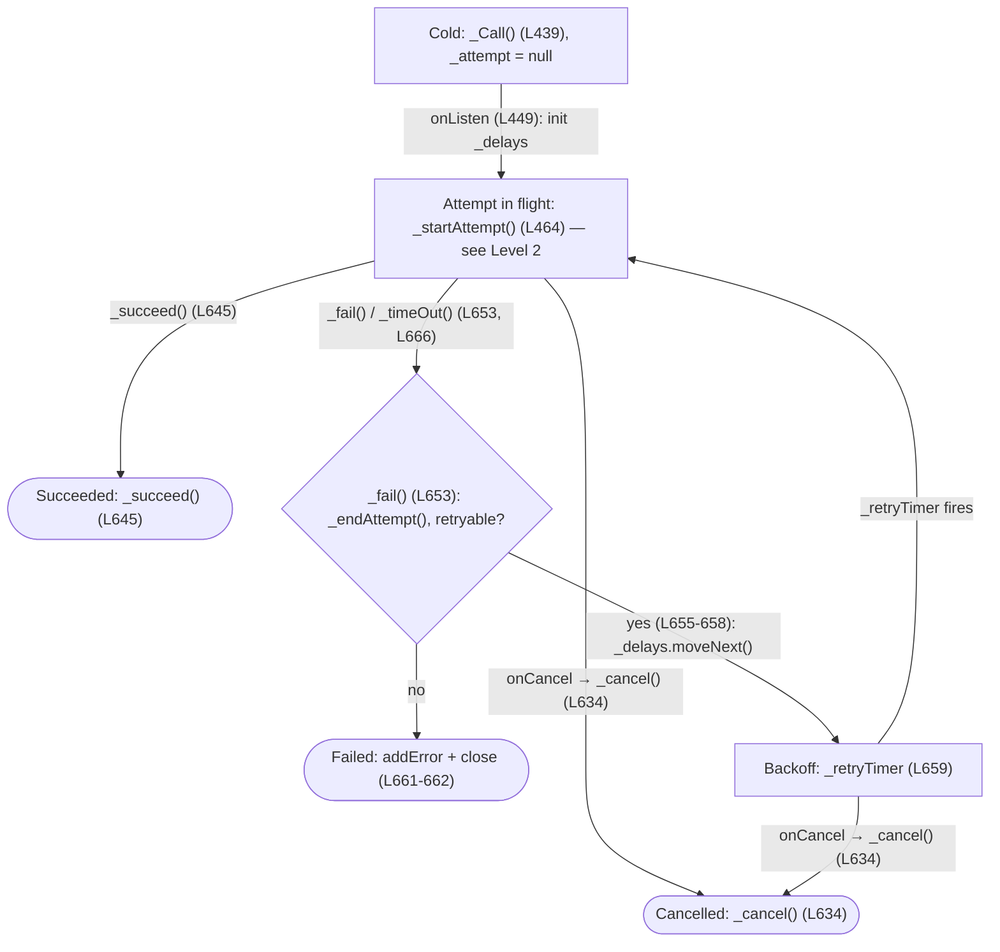
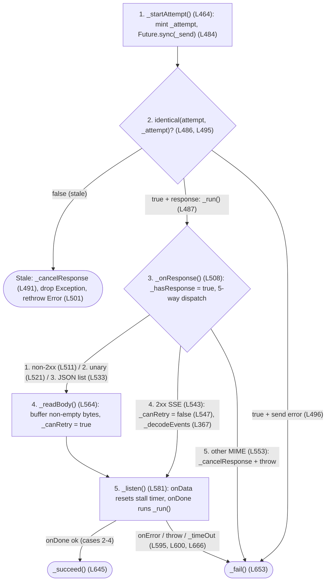
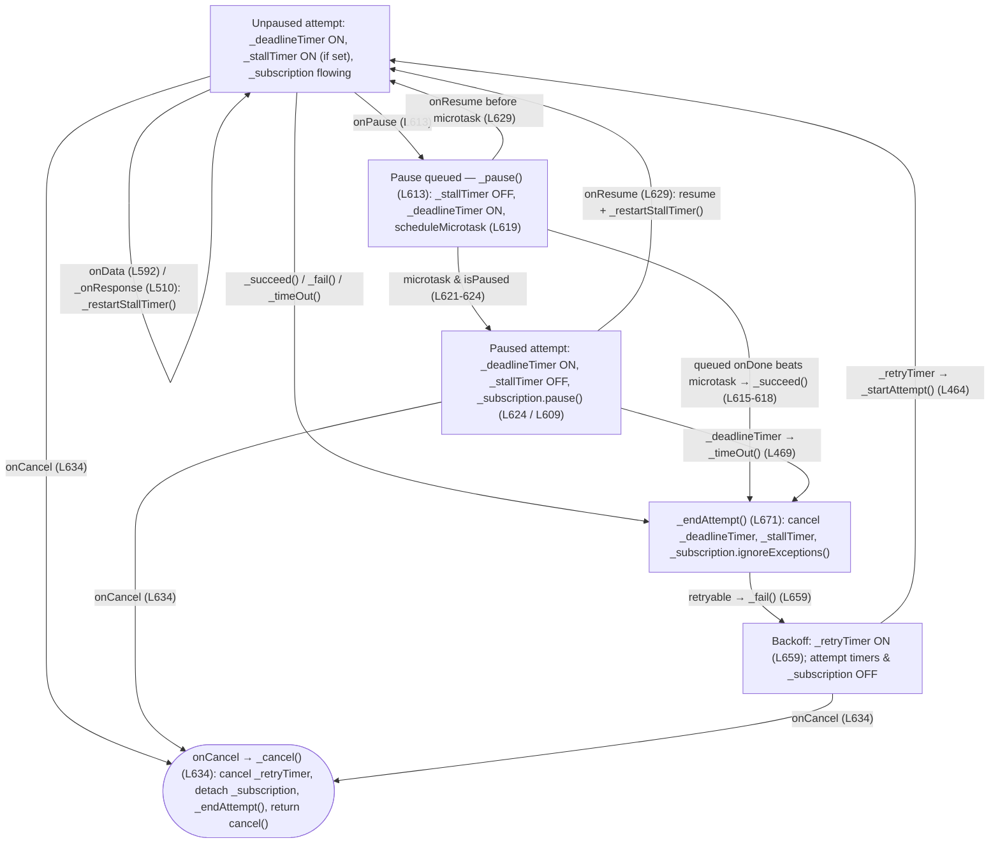

# `ServiceClient` (`_Call`) State Machine

[`_Call`](lib/service_client.dart#L408-L707) drives both unary and streaming
RPCs in [`lib/service_client.dart`](lib/service_client.dart). Every external
event runs in a synchronous method with no `await`, so call state cannot change
mid-transition. Each attempt mints a fresh `_attempt = Object()` token
([L465](lib/service_client.dart#L465)) cleared in `_endAttempt()`
([L672](lib/service_client.dart#L672)) to invalidate stale callbacks.

To avoid crossed edges, `_Call` is split into three progressive zoom levels:

1. **Level 1** — Call and retry loop across attempts.
2. **Level 2** — Inside a single attempt (`_send`, token guard, 5-way dispatch).
3. **Level 3** — Orthogonal timers and subscription pause/resume/cancel.

## Level 1 — Call & Retry Loop

- **Cold vs. immediate start**:
  [`_makeRequest`](lib/service_client.dart#L303-L319) subscribes immediately
  via `.messages.single` ([L318](lib/service_client.dart#L318)), whereas
  [`_makeStreamingRequest`](lib/service_client.dart#L325-L347) returns the
  cold stream ([L346](lib/service_client.dart#L346)) and defers body encoding
  ([L338](lib/service_client.dart#L338)). `onPause`, `onResume`, and `onCancel`
  are wired inside `onListen` ([L449–L456](lib/service_client.dart#L449-L456)).
- **Retry predicate** ([`_fail`](lib/service_client.dart#L653-L664)): always
  calls [`_endAttempt()`](lib/service_client.dart#L671-L677) first, then starts
  `_retryTimer` ([L659](lib/service_client.dart#L659)) only when `_canRetry`,
  `error is Exception`, `_retry.isRetryable(error)`, and `_delays.moveNext()`
  all hold ([L655–L658](lib/service_client.dart#L655-L658)).
- **Terminal exits**: [`_succeed`](lib/service_client.dart#L645-L648) calls
  `_endAttempt()` and closes `_controller`; non-retryable
  [`_fail`](lib/service_client.dart#L660-L663) emits the error and closes;
  [`_cancel`](lib/service_client.dart#L634-L642) cancels `_retryTimer`, calls
  `_endAttempt()`, and returns `subscription?.cancel()`.

## Level 2 — Inside One Attempt

### 5-Way Dispatch in [`_onResponse`](lib/service_client.dart#L508-L561)

| # | Branch | `_canRetry` | Reader | `onDone` / Result | Lines |
|---|---|---|---|---|---|
| 1 | Non-2xx status | `true` | `_readBody` | Throws `ServiceException.fromHttpResponse` → `_fail` | [L511–L520](lib/service_client.dart#L511-L520) |
| 2 | 2xx unary (`!_isStreaming`) | `true` | `_readBody` | Decodes JSON (or `{}`), `_controller.add`, `_succeed` | [L521–L530](lib/service_client.dart#L521-L530) |
| 3 | 2xx streaming `application/json` | `true` | `_readBody` | Decodes JSON `List`, adds each item, `_succeed` | [L533–L542](lib/service_client.dart#L533-L542) |
| 4 | 2xx streaming `text/event-stream` | `false` | `_listen(_decodeEvents)` | Emits SSE `data: ` events live, then `_succeed` | [L543–L552](lib/service_client.dart#L543-L552) |
| 5 | 2xx streaming other `content-type` | `true` | none (`_cancelResponse`) | Throws `ServiceException` via `_run` → `_fail` | [L553–L559](lib/service_client.dart#L553-L559) |

- **Stale `_send` settlement** ([L486–L503](lib/service_client.dart#L486-L503)):
  because `_send` is not aborted on timeout or cancel, `_endAttempt()` clears
  `_attempt = null` so a late settlement takes the `false (stale)` branch —
  cancelling a late response via
  [`_cancelResponse`](lib/service_client.dart#L710-L711)`.ignoreExceptions()`,
  dropping a late `Exception`, and rethrowing a late `Error` uncaught
  ([L501](lib/service_client.dart#L501)).
- **Synchronous-done streams** ([L603–L610](lib/service_client.dart#L603-L610)):
  if `stream.listen` finishes or errors synchronously before returning,
  `isOver()` is already `true`; `_listen` cancels the returned subscription and
  leaves `_subscription` `null`.
- **What counts as server life**:
  [`_readBody`](lib/service_client.dart#L564-L575) filters out empty chunks
  ([L571](lib/service_client.dart#L571)) so they do not reset `_stallTimer`;
  SSE uses [`_decodeEvents`](lib/service_client.dart#L367-L383), so only
  complete `data: ` JSON events reset it.

## Level 3 — Timers & Pause/Resume

### Resource Lifecycle Summary

| Resource | Started / Attached | Reset | On Pause / Resume | Cancelled / Timeout Message |
|---|---|---|---|---|
| `_deadlineTimer` ([L435](lib/service_client.dart#L435)) | `_startAttempt` if `_timeout != null` ([L468](lib/service_client.dart#L468)) | never | keeps running across pause | `_endAttempt` ([L673](lib/service_client.dart#L673)); before headers: `"did not return any data"`, after: `"did not complete"` ([L472–L474](lib/service_client.dart#L472-L474)) |
| `_stallTimer` ([L436](lib/service_client.dart#L436)) | `_restartStallTimer` if `_stallTimeout != null`, active, and unpaused ([L691–L695](lib/service_client.dart#L691-L695)) | `_startAttempt` ([L479](lib/service_client.dart#L479)), `_onResponse` ([L510](lib/service_client.dart#L510)), `onData` ([L592](lib/service_client.dart#L592)), `_resume` ([L631](lib/service_client.dart#L631)) | cancelled immediately in `_pause` ([L614](lib/service_client.dart#L614)); restarted in `_resume` ([L631](lib/service_client.dart#L631)) | `_endAttempt` ([L674](lib/service_client.dart#L674)); before headers: `"did not return any data"`, after: `"No data received"` ([L700–L702](lib/service_client.dart#L700-L702)) |
| `_retryTimer` ([L437](lib/service_client.dart#L437)) | `_fail` when retryable ([L659](lib/service_client.dart#L659)) | never | unaffected | `_cancel` ([L635](lib/service_client.dart#L635)) |
| `_subscription` ([L433](lib/service_client.dart#L433)) | `_listen` ([L608](lib/service_client.dart#L608)), cleared on `onDone` ([L599](lib/service_client.dart#L599)) | — | paused 1 microtask after `_pause` ([L619–L626](lib/service_client.dart#L619-L626)) or immediately in `_listen` if already paused ([L609](lib/service_client.dart#L609)); resumed in `_resume` ([L630](lib/service_client.dart#L630)) | `_endAttempt` calls `ignoreExceptions()` ([L675](lib/service_client.dart#L675)); `_cancel` returns `cancel()` ([L641](lib/service_client.dart#L641)) |

- **1-microtask pause deferral**
  ([`_pause`](lib/service_client.dart#L613-L627)): `_stallTimer` stops
  immediately ([L614](lib/service_client.dart#L614)), while
  `_subscription.pause()` waits one microtask
  ([L619–L626](lib/service_client.dart#L619-L626)). If the listener pauses on
  the last event while `onDone` is already queued behind it, `onDone` runs
  first and calls `_succeed()`, cancelling `_deadlineTimer` so an
  already-finished stream cannot time out while paused. If `onResume` or
  `onCancel` runs before the microtask, the guard at
  [L621–L623](lib/service_client.dart#L621-L623) makes the microtask a no-op.
- **Paused before `_subscription` attaches**
  ([L609](lib/service_client.dart#L609), [L693](lib/service_client.dart#L693)):
  if `_controller.isPaused` is already `true` when `_retryTimer` starts a new
  attempt or when headers arrive, `_restartStallTimer()` skips starting
  `_stallTimer` and `_listen()` pauses `_subscription` synchronously.
- **Caller cancel vs. internal cleanup**
  ([`_cancel`](lib/service_client.dart#L634-L642) vs.
  [`_endAttempt`](lib/service_client.dart#L671-L677)): `_cancel()` detaches
  `_subscription` before calling `_endAttempt()` and returns
  `subscription?.cancel()` so cancel errors propagate to the caller.
  `_endAttempt()` calls
  [`ignoreExceptions()`](lib/service_client.dart#L717-L721), swallowing
  `Exception`s while letting `Error`s surface.
