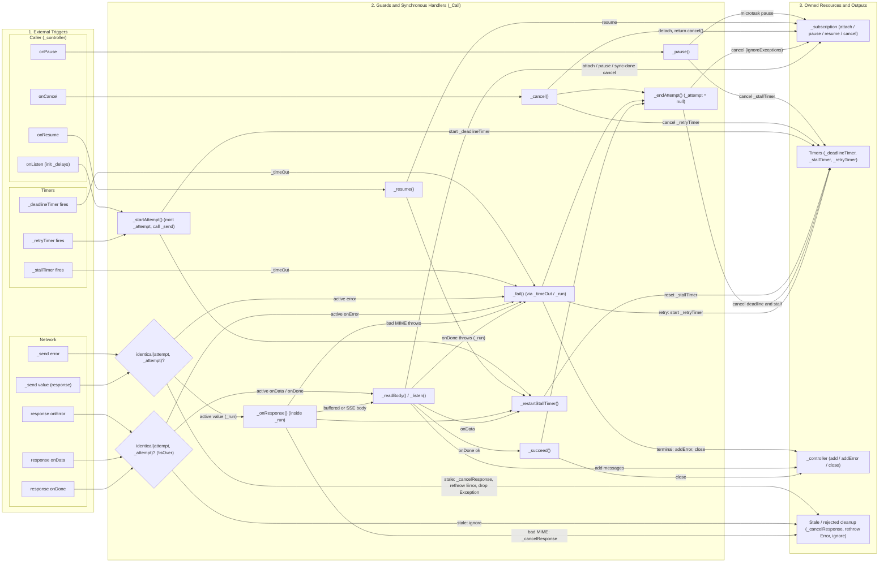
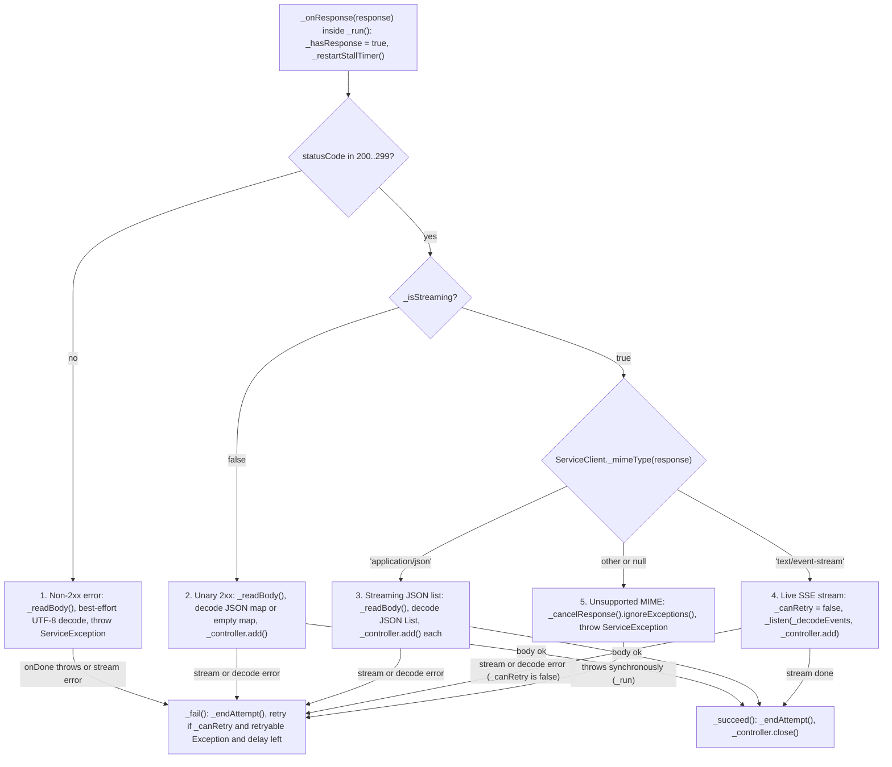

# `ServiceClient` (`_Call`) Event-Driven Architecture

[`_Call`](lib/service_client.dart#L408-L707) in
[`lib/service_client.dart`](lib/service_client.dart) executes unary and
streaming RPCs with retries, per-attempt `timeout`, `streamWaitTimeout`,
pause/resume, and cancellation.

Rather than switching on a state enum, `_Call` is a single-threaded reactive
object. Every external trigger invokes a synchronous method (no `await`), so
the call's fields cannot change mid-handler. Instead of tracking explicit
states, each attempt mints a fresh identity token (`_attempt = Object()`).
Asynchronous callbacks from `_send` and response streams check
`identical(attempt, _attempt)` to ignore or clean up completions from abandoned
attempts, while timers are cancelled synchronously when no longer valid.

Entry points in [`ServiceClient`](lib/service_client.dart#L71-L390):

- **Unary** ([`_makeRequest`](lib/service_client.dart#L303-L319)): eagerly
  encodes `body`, constructs `_Call(..., isStreaming: false)` with no
  `stallTimeout`, and returns `.messages.single`, which triggers `onListen`
  immediately.
- **Streaming**
  ([`_makeStreamingRequest`](lib/service_client.dart#L325-L347)): optionally
  adds `alt=sse` via
  [`_makeUrlStreaming`](lib/service_client.dart#L385-L389), encodes `body`
  lazily on first send, constructs
  `_Call(..., stallTimeout: streamWaitTimeout, isStreaming: true)`, and returns
  `.messages` so nothing starts until the caller listens.

## Trigger-to-Handler Wiring

### Handler Semantics

- **Constructor & `onListen`** ([`_Call`](lib/service_client.dart#L439-L457)):
  wires `onPause`, `onResume`, and `onCancel`, initializes `_delays` from
  `_retry.delays().iterator`, and calls
  [`_startAttempt`](lib/service_client.dart#L464-L506).
- **Attempt startup & stale `_send` guard**
  ([`_startAttempt`](lib/service_client.dart#L464-L506)): mints
  `attempt = _attempt = Object()`, resets `_canRetry = true` and
  `_hasResponse = false`, starts `_deadlineTimer` (if `_timeout != null`) and
  `_stallTimer`, and invokes `Future.sync(_send)` so synchronous throws from
  [`ServiceClient._send`](lib/service_client.dart#L284-L301) or lazy body
  encoding still flow through `onError`. Because `_send` is not aborted on
  timeout or cancel, a late `response` (`!identical(attempt, _attempt)`) is
  released via [`_cancelResponse`](lib/service_client.dart#L710-L711) with
  [`ignoreExceptions`](lib/service_client.dart#L718-L720); a late `Exception`
  is dropped, while a late `Error` is rethrown uncaught via
  `Error.throwWithStackTrace` ([L497–L502](lib/service_client.dart#L497-L502)).
- **Response reading & stream guard**
  ([`_readBody`](lib/service_client.dart#L564-L575),
  [`_listen`](lib/service_client.dart#L581-L611)): `_readBody` filters out
  empty byte chunks ([L571](lib/service_client.dart#L571)) so they do not reset
  `_stallTimer`, buffers chunks in a `BytesBuilder`, and passes the completed
  bytes to `onDone`. `_listen` captures `attempt` and guards `onData`,
  `onError`, and `onDone` with `isOver()` (`!identical(attempt, _attempt)`). On
  `onData`, it runs `onData(event)` and calls `_restartStallTimer()`. On
  `onDone`, it clears `_subscription = null` and executes `_run(onDone)`. If
  `stream.listen(...)` completes or errors synchronously before returning,
  `isOver()` is already `true` ([L603–L606](lib/service_client.dart#L603-L606))
  and `_listen` cancels the returned subscription immediately without storing
  it; otherwise it stores `_subscription` and pauses it right away if
  `_controller.isPaused` ([L608–L609](lib/service_client.dart#L608-L609)).
- **Pause & resume** ([`_pause`](lib/service_client.dart#L613-L627),
  [`_resume`](lib/service_client.dart#L629-L632)): `_pause` cancels
  `_stallTimer` immediately (`_deadlineTimer` keeps running) and defers
  `subscription.pause()` via `scheduleMicrotask`. Deferring lets an
  already-queued `onDone` behind the current event run and call `_succeed()`
  first, preventing a finished response from timing out while paused. `_resume`
  resumes `_subscription` and calls `_restartStallTimer()`.
- **Caller cancel vs. internal teardown**
  ([`_cancel`](lib/service_client.dart#L634-L642),
  [`_endAttempt`](lib/service_client.dart#L671-L677)): `_cancel` cancels
  `_retryTimer`, detaches `_subscription` into a local before calling
  `_endAttempt()`, and returns `subscription?.cancel()` so cancellation errors
  propagate to the caller. `_endAttempt` clears `_attempt = null`, cancels
  `_deadlineTimer` and `_stallTimer`, cancels `_subscription` via
  `ignoreExceptions()`, and nulls `_subscription` (it never touches
  `_retryTimer`).
- **Success, failure, timeouts, and retries**
  ([`_succeed`](lib/service_client.dart#L645-L648),
  [`_fail`](lib/service_client.dart#L653-L664),
  [`_timeOut`](lib/service_client.dart#L666-L667),
  [`_run`](lib/service_client.dart#L681-L687)): `_succeed` calls
  `_endAttempt()` and closes `_controller`. `_run` wraps `_onResponse` and
  stream `onDone` callbacks so any throw routes to `_fail`. `_timeOut` builds a
  `TimeoutException` and calls `_fail`. `_fail` calls `_endAttempt()` and
  schedules `_retryTimer = Timer(_delays.current, _startAttempt)` only when
  `_canRetry && error is Exception && _retry.isRetryable(error) &&
  _delays.moveNext()` ([L655–L659](lib/service_client.dart#L655-L659));
  otherwise it emits the error on `_controller` and closes it.
- **Stall-timer resets**
  ([`_restartStallTimer`](lib/service_client.dart#L691-L706)): exits early if
  `_stallTimeout == null`, `_attempt == null`, or `_controller.isPaused`;
  otherwise cancels any prior `_stallTimer` and starts a new one.

## Response Branching in `_onResponse()`

[`_onResponse`](lib/service_client.dart#L508-L561) runs inside `_run()` when
headers arrive for the active attempt. It first marks `_hasResponse = true` and
resets `_stallTimer`, then dispatches into one of five paths:

Key details of the five branches:

- **Point of no return**: Branch 4 (`text/event-stream`) is the only branch
  that sets `_canRetry = false` ([L547](lib/service_client.dart#L547)), because
  events from [`ServiceClient._decodeEvents`](lib/service_client.dart#L367-L383)
  reach the caller as they arrive. Branches 1–3 buffer the full body in
  `_readBody` first, and branch 5 fails immediately after releasing the
  connection via `_cancelResponse`.
- **MIME parsing**:
  [`ServiceClient._mimeType`](lib/service_client.dart#L351-L359) uses
  `http.MediaType.parse`, which strips parameters such as `; charset=utf-8` and
  returns `null` if the header is missing or malformed.
- **Timeout message selection**: Before `_onResponse` sets `_hasResponse = true`
  ([L509](lib/service_client.dart#L509)), both `_deadlineTimer` and
  `_stallTimer` report `'Request to $_url did not return any data'`. Afterward,
  `_deadlineTimer` reports `'Request to $_url did not complete'`
  ([L472–L474](lib/service_client.dart#L472-L474)) and `_stallTimer` reports
  `'No data received from $_url'`
  ([L700–L702](lib/service_client.dart#L700-L702)).

## `_Call` Field Ownership

Every field declared on [`_Call`](lib/service_client.dart#L409-L437), what it
represents, which methods mutate it, and which methods read or cancel it:

| Field | Purpose | Written by | Read / cancelled by |
|---|---|---|---|
| [`_url`](lib/service_client.dart#L409) (`final Uri`) | Request URI (with `alt=sse` when enabled), used in timeout messages | Constructor ([L440](lib/service_client.dart#L440)) | `_deadlineTimer` callback ([L473–L474](lib/service_client.dart#L473-L474)), `_stallTimer` callback ([L701–L702](lib/service_client.dart#L701-L702)) |
| [`_send`](lib/service_client.dart#L410) (`final Future<...> Function()`) | Per-attempt factory building a fresh `http.Request` and calling `client.send` | Constructor ([L441](lib/service_client.dart#L441)) | `_startAttempt` via `Future.sync(_send)` ([L484](lib/service_client.dart#L484)) |
| [`_retry`](lib/service_client.dart#L411) (`final RetryRunner`) | Retry policy supplying backoff delays and `isRetryable` predicate | Constructor ([L442](lib/service_client.dart#L442)) | `onListen` ([L454](lib/service_client.dart#L454)), `_fail` ([L657](lib/service_client.dart#L657)) |
| [`_timeout`](lib/service_client.dart#L412) (`final Duration?`) | Per-attempt total deadline (counts paused time); `null` disables deadline | Constructor ([L446](lib/service_client.dart#L446)) | `_startAttempt` ([L468–L476](lib/service_client.dart#L468-L476)) |
| [`_stallTimeout`](lib/service_client.dart#L413) (`final Duration?`) | Max unpaused wait before headers or between events (`null` for unary calls) | Constructor ([L447](lib/service_client.dart#L447)) | `_restartStallTimer` ([L692–L704](lib/service_client.dart#L692-L704)) |
| [`_isStreaming`](lib/service_client.dart#L416) (`final bool`) | Whether to treat 2xx responses as streaming (JSON list / SSE) vs. single map | Constructor ([L448](lib/service_client.dart#L448)) | `_onResponse` ([L521](lib/service_client.dart#L521)) |
| [`_controller`](lib/service_client.dart#L418) (`final StreamController`) | Output stream backing `.messages`, caller lifecycle hooks, and pause state | Initializer ([L418](lib/service_client.dart#L418)), constructor `onListen` ([L449–L453](lib/service_client.dart#L449-L453)), `_onResponse` `add` ([L524](lib/service_client.dart#L524), [L540](lib/service_client.dart#L540), [L550](lib/service_client.dart#L550)), `_succeed` `close` ([L647](lib/service_client.dart#L647)), `_fail` `addError`/`close` ([L661–L662](lib/service_client.dart#L661-L662)) | `messages` getter ([L462](lib/service_client.dart#L462)); `.isPaused` in `_listen` ([L609](lib/service_client.dart#L609)), `_pause` microtask ([L623](lib/service_client.dart#L623)), `_restartStallTimer` ([L693](lib/service_client.dart#L693)) |
| [`_delays`](lib/service_client.dart#L421) (`late final Iterator<Duration>`) | Remaining retry backoff delays for this call | `onListen` initializes ([L454](lib/service_client.dart#L454)); `_fail` advances via `moveNext()` ([L658](lib/service_client.dart#L658)) | `_fail` reads `current` ([L659](lib/service_client.dart#L659)) |
| [`_attempt`](lib/service_client.dart#L424) (`Object?`) | Identity token for the active attempt, or `null` when no attempt is running | `_startAttempt` mints `Object()` ([L465](lib/service_client.dart#L465)); `_endAttempt` sets `null` ([L672](lib/service_client.dart#L672)) | `_startAttempt` `.then` / `onError` ([L486](lib/service_client.dart#L486), [L495](lib/service_client.dart#L495)), `_listen` `isOver()` ([L586–L603](lib/service_client.dart#L586-L603)), `_restartStallTimer` ([L693](lib/service_client.dart#L693)) |
| [`_canRetry`](lib/service_client.dart#L427) (`bool`) | Whether failures in the active attempt may still be retried | Initializer `true` ([L427](lib/service_client.dart#L427)), `_startAttempt` resets `true` ([L466](lib/service_client.dart#L466)), `_onResponse` sets `false` on SSE ([L547](lib/service_client.dart#L547)) | `_fail` ([L655](lib/service_client.dart#L655)) |
| [`_hasResponse`](lib/service_client.dart#L430) (`bool`) | Whether headers arrived for the active attempt (selects timeout message) | Initializer `false` ([L430](lib/service_client.dart#L430)), `_startAttempt` resets `false` ([L467](lib/service_client.dart#L467)), `_onResponse` sets `true` ([L509](lib/service_client.dart#L509)) | `_deadlineTimer` callback ([L472](lib/service_client.dart#L472)), `_stallTimer` callback ([L700](lib/service_client.dart#L700)) |
| [`_subscription`](lib/service_client.dart#L433) (`StreamSubscription?`) | Active subscription to the response byte stream or decoded SSE event stream | `_listen` attaches ([L608](lib/service_client.dart#L608)) and `onDone` clears ([L599](lib/service_client.dart#L599)), `_cancel` detaches ([L639](lib/service_client.dart#L639)), `_endAttempt` clears ([L676](lib/service_client.dart#L676)) | `_pause` microtask ([L620–L624](lib/service_client.dart#L620-L624)), `_resume` ([L630](lib/service_client.dart#L630)), `_cancel` returns `cancel()` ([L638–L641](lib/service_client.dart#L638-L641)), `_endAttempt` cancels ignoring exceptions ([L675](lib/service_client.dart#L675)) |
| [`_deadlineTimer`](lib/service_client.dart#L435) (`Timer?`) | Per-attempt deadline timer (`_timeout`) | `_startAttempt` ([L469](lib/service_client.dart#L469)) | `_endAttempt` cancels ([L673](lib/service_client.dart#L673)) |
| [`_stallTimer`](lib/service_client.dart#L436) (`Timer?`) | Unpaused inactivity timer (`_stallTimeout`) | `_restartStallTimer` ([L697](lib/service_client.dart#L697)) | `_pause` ([L614](lib/service_client.dart#L614)), `_endAttempt` ([L674](lib/service_client.dart#L674)), `_restartStallTimer` ([L696](lib/service_client.dart#L696)) |
| [`_retryTimer`](lib/service_client.dart#L437) (`Timer?`) | Backoff timer between failed attempts | `_fail` ([L659](lib/service_client.dart#L659)) | `_cancel` cancels ([L635](lib/service_client.dart#L635)) |
