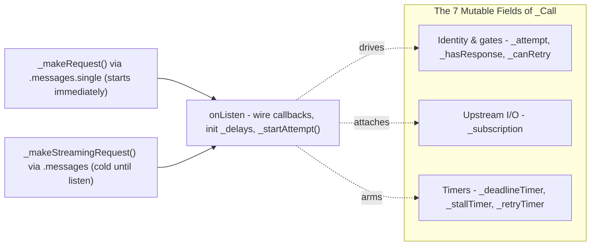
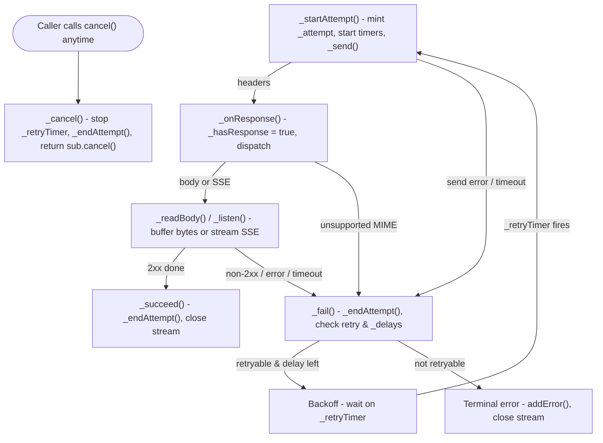

# Follow a Request Through `_Call`

[`_Call`](lib/service_client.dart#L408-L707) in
[`lib/service_client.dart`](lib/service_client.dart) runs every unary and
streaming RPC for [`ServiceClient`](lib/service_client.dart#L71), handling
retries, `timeout`, `streamWaitTimeout`, pause/resume, and cancellation.

The design rule that makes `_Call` easy to follow is stated in its class doc
([L404-L407](lib/service_client.dart#L404-L407)): **no method on `_Call` uses
`await`**. Every external event — listener callbacks, `http.Client.send`
completions, response stream events, and timers — runs synchronously to
completion, so fields can never change mid-method.

## 1. The 7 Fields of `_Call` in One Picture

Both public request paths enter `_Call` through
[`_controller.stream`](lib/service_client.dart#L462) (`messages`):

- **Unary calls** ([`_makeRequest`](lib/service_client.dart#L303-L319)):
  encodes `body` eagerly ([L311](lib/service_client.dart#L311)), sets
  `isStreaming: false` (leaving `_stallTimeout == null`), and returns
  `.messages.single` ([L318](lib/service_client.dart#L318)). Because `.single`
  subscribes immediately, `onListen` fires synchronously and starts attempt 1
  right away.
- **Streaming calls**
  ([`_makeStreamingRequest`](lib/service_client.dart#L325-L347)): appends
  `alt=sse` when `enableSse` is `true`
  ([`_makeUrlStreaming`](lib/service_client.dart#L385-L389)), encodes `body`
  lazily with `late final` ([L338](lib/service_client.dart#L338)), sets
  `isStreaming: true` and `stallTimeout: streamWaitTimeout`, and returns the
  cold `.messages` stream ([L346](lib/service_client.dart#L346)). Nothing is
  sent until the caller calls `.listen(...)`.

Once subscribed, [`onListen`](lib/service_client.dart#L449-L456) wires
`onPause`/`onResume`/`onCancel`, creates the retry-delay iterator
[`_delays`](lib/service_client.dart#L421) once
([L454](lib/service_client.dart#L454)), and calls
[`_startAttempt()`](lib/service_client.dart#L455). From there, all mutable
state lives in seven fields grouped into three roles:

| Role | Field | Type | Written by | Why it exists |
|---|---|---|---|---|
| Identity | [`_attempt`](lib/service_client.dart#L424) | `Object?` | [`_startAttempt`](lib/service_client.dart#L465) (`Object()`), [`_endAttempt`](lib/service_client.dart#L672) (`null`) | Unique token for the in-flight attempt; lets late callbacks detect `!identical(attempt, _attempt)`. |
| Gate | [`_canRetry`](lib/service_client.dart#L427) | `bool` | [`_startAttempt`](lib/service_client.dart#L466) (`true`), [`_onResponse`](lib/service_client.dart#L547) (`false` on SSE) | Checked in [`_fail`](lib/service_client.dart#L655). Stays `true` for buffered bodies; flips to `false` once live SSE events can reach the caller. |
| Phase | [`_hasResponse`](lib/service_client.dart#L430) | `bool` | [`_startAttempt`](lib/service_client.dart#L467) (`false`), [`_onResponse`](lib/service_client.dart#L509) (`true`) | Read **only** by the two timeout callbacks ([L472](lib/service_client.dart#L472), [L700](lib/service_client.dart#L700)) to choose the `TimeoutException` message. |
| I/O | [`_subscription`](lib/service_client.dart#L433) | `StreamSubscription?` | [`_listen`](lib/service_client.dart#L608), cleared at [L599](lib/service_client.dart#L599), [L639](lib/service_client.dart#L639), [L676](lib/service_client.dart#L676) | Active subscription to raw response byte chunks (`_readBody`) or decoded SSE events (`_decodeEvents`). |
| Clock | [`_deadlineTimer`](lib/service_client.dart#L435) | `Timer?` | [`_startAttempt`](lib/service_client.dart#L469), cancelled in [`_endAttempt`](lib/service_client.dart#L673) | Enforces `timeout` across one entire attempt, **including** paused time. Inactive during retry backoff. |
| Clock | [`_stallTimer`](lib/service_client.dart#L436) | `Timer?` | [`_restartStallTimer`](lib/service_client.dart#L697), cancelled in [`_pause`](lib/service_client.dart#L614) and [`_endAttempt`](lib/service_client.dart#L674) | Enforces `streamWaitTimeout` while unpaused (always `null` for unary calls). Resets on start, headers, data, and resume. |
| Clock | [`_retryTimer`](lib/service_client.dart#L437) | `Timer?` | [`_fail`](lib/service_client.dart#L659), cancelled in [`_cancel`](lib/service_client.dart#L635) | Sleeps for `_delays.current` between failed attempts before calling `_startAttempt()`. Never overlaps `_attempt`. |

Two details jump out from that table once you know where to look:

- **Pause state is not a field on `_Call`**:
  [`_controller`](lib/service_client.dart#L418) (`StreamController`) tracks it
  in `_controller.isPaused`, which `_listen`, `_pause`, and
  `_restartStallTimer` query directly.
- **`_hasResponse` only shapes error wording**: before headers arrive
  (`false`), both timers throw `'Request to $_url did not return any data'`;
  after headers arrive (`true`), `_deadlineTimer` throws
  `'Request to $_url did not complete'` and `_stallTimer` throws
  `'No data received from $_url'`.

## 2. The High-Level Flow

Every call moves along three simple tracks: a straight **happy path** down the
left, a **retry / failure loop** on the right, and an out-of-band **cancel
path** that can fire at any point.

Inside [`_onResponse()`](lib/service_client.dart#L508-L561), the response
headers pick one of four branches:

1. **Non-2xx status** ([L511-L520](lib/service_client.dart#L511-L520)): reads
   the entire body via [`_readBody`](lib/service_client.dart#L564-L575), then
   throws `ServiceException.fromHttpResponse(...)`. Because `_listen`'s
   `onDone` runs inside [`_run`](lib/service_client.dart#L681-L687), that throw
   routes straight to [`_fail`](lib/service_client.dart#L653-L664).
2. **2xx unary (`!_isStreaming`)**
   ([L521-L530](lib/service_client.dart#L521-L530)): reads the entire body via
   `_readBody`, decodes one JSON map (or `{}` if empty), emits it with
   `_controller.add`, and calls `_succeed()`.
3. **2xx streaming, `application/json`**
   ([L533-L542](lib/service_client.dart#L533-L542)): reads the entire body via
   `_readBody` with `_canRetry` still `true`, decodes the JSON `List`, emits
   each map, and calls `_succeed()`.
4. **2xx streaming, `text/event-stream`**
   ([L543-L552](lib/service_client.dart#L543-L552)): sets `_canRetry = false`
   ([L547](lib/service_client.dart#L547)) and attaches
   [`_listen`](lib/service_client.dart#L581-L611) directly to
   [`ServiceClient._decodeEvents`](lib/service_client.dart#L367-L383) so each
   `data: ` event flows immediately to `_controller.add`. Any other MIME type
   cancels the response and throws `ServiceException`
   ([L553-L558](lib/service_client.dart#L553-L558)).

Also note [`Future.sync(_send)`](lib/service_client.dart#L484): if `_send()`
throws synchronously (for example, if lazy `body._asEncodedJson` throws on a
streaming call), `Future.sync` converts it into an async error handled by
`_fail()`.

## 3. Step-by-Step Field Snapshot Walkthroughs

The tables below trace the live values of `_Call`'s fields beat by beat. Note
that cancelling a Dart `Timer` calls `.cancel()` on the existing instance
without reassigning the field to `null`, so cancelled timers are shown as
`cancelled`.

### Walkthrough A: Unary Call Hits HTTP 503, Retries, and Succeeds

Assume the caller runs `service.get(url, retry: retry, timeout: 5s)` where
`retry` retries 503 responses after a `100ms` delay. Because this is a unary
call, `_stallTimeout` is `null` so `_stallTimer` stays `null` throughout.

| Beat | Method & Line | `_attempt` | `_hasResponse` | `_canRetry` | `_subscription` | Timers (`_deadlineTimer` / `_retryTimer`) |
|---|---|---|---|---|---|---|
| 1. Call starts immediately | [`_makeRequest`](lib/service_client.dart#L312-L318) -> [`onListen`](lib/service_client.dart#L449-L456) -> [`_startAttempt`](lib/service_client.dart#L464-L506) | `A1` | `false` | `true` | `null` | deadline: running (5s) / retry: `null` |
| 2. 503 headers arrive | [`_onResponse`](lib/service_client.dart#L508-L520) -> [`_readBody`](lib/service_client.dart#L564-L575) -> [`_listen`](lib/service_client.dart#L581-L611) | `A1` | `true` | `true` | `bytesSub1` | deadline: running / retry: `null` |
| 3. 503 body bytes arrive | [`_listen` `onData`](lib/service_client.dart#L589-L593) | `A1` | `true` | `true` | `bytesSub1` | deadline: running / retry: `null` |
| 4. 503 body ends -> retry | [`_listen` `onDone`](lib/service_client.dart#L597-L601) -> [`_run`](lib/service_client.dart#L681-L687) -> [`_fail`](lib/service_client.dart#L653-L664) -> [`_endAttempt`](lib/service_client.dart#L671-L677) | `null` | `true` | `true` | `null` | deadline: cancelled / retry: running (100ms) |
| 5. Backoff fires -> attempt 2 | [`_startAttempt`](lib/service_client.dart#L464-L506) (from [L659](lib/service_client.dart#L659)) | `A2` | `false` | `true` | `null` | deadline: running (5s) / retry: fired |
| 6. 200 OK headers arrive | [`_onResponse`](lib/service_client.dart#L521-L530) -> [`_readBody`](lib/service_client.dart#L564-L575) -> [`_listen`](lib/service_client.dart#L581-L611) | `A2` | `true` | `true` | `bytesSub2` | deadline: running / retry: fired |
| 7. 200 body ends -> succeed | [`_listen` `onDone`](lib/service_client.dart#L597-L601) -> [`_succeed`](lib/service_client.dart#L645-L648) -> [`_endAttempt`](lib/service_client.dart#L671-L677) | `null` | `true` | `true` | `null` | deadline: cancelled / retry: fired |

Key moments to notice as you read along in the code:

- **Beat 2 -> 3**: `_readBody` filters out empty chunks with
  `.where((chunk) => chunk.isNotEmpty)` ([L571](lib/service_client.dart#L571))
  and appends each chunk to a local `BytesBuilder`.
- **Beat 4**: `onDone` clears `_subscription = null`
  ([L599](lib/service_client.dart#L599)) *before* calling `_run(onDone)` so
  `_endAttempt()` won't redundantly cancel an already-finished stream. Next,
  the 503 callback throws `ServiceException`, `_run` forwards it to `_fail`,
  and `_fail` calls `_endAttempt()` first ([L654](lib/service_client.dart#L654))
  — which intentionally leaves `_canRetry` intact so line
  [L655](lib/service_client.dart#L655) can read it. Notice `_hasResponse` also
  remains `true` during backoff until Beat 5 resets it at
  [L467](lib/service_client.dart#L467).
- **Beat 5**: `_send` creates a brand-new `http.Request`
  ([L290](lib/service_client.dart#L290)) because `http.Client.send` finalizes
  each request object, and `_startAttempt` mints a fresh `A2` token and a fresh
  5s `_deadlineTimer` (timeouts are per attempt).
- **Beat 7**: `_controller.add(decodedMap)` delivers the single message and
  `_succeed()` closes `_controller`, completing the caller's `.messages.single`
  `Future`.
- **What changes for a streaming `application/json` JSON-list call?** Only two
  things: Beat 1 waits in `Idle` (`_attempt == null`) until the caller calls
  `.listen(...)`, and Beats 6–7 hit
  [L533-L542](lib/service_client.dart#L533-L542) instead of
  [L521-L530](lib/service_client.dart#L521-L530) (emitting each list element
  before `_succeed()`, with `_stallTimer` also resetting on each non-empty
  chunk if `streamWaitTimeout` is set).

### Walkthrough B: SSE Stream Pauses Inside `onData` on the Last Event

Now consider a streaming call with `enableSse: true`, `timeout: 10s`, and
`streamWaitTimeout: 3s`. The server returns `200 OK` (`text/event-stream`) with
a single event `data: {"fruit":"apple"}\n` followed immediately by EOF. Inside
`onData`, the caller pauses the subscription for `20s` — **longer than
`timeout`** — to do slow work before resuming. `_retryTimer` stays `null`
throughout.

| Beat | Method & Line | `_attempt` | `_hasResponse` | `_canRetry` | `_subscription` | Timers (`_deadlineTimer` / `_stallTimer`) | `isPaused` |
|---|---|---|---|---|---|---|---|
| 1. Cold stream returned | [`_makeStreamingRequest`](lib/service_client.dart#L325-L347) -> [`_Call`](lib/service_client.dart#L439-L457) | `null` | `false` | `true` | `null` | `null` / `null` | `false` |
| 2. Caller calls `.listen()` | [`onListen`](lib/service_client.dart#L449-L456) -> [`_startAttempt`](lib/service_client.dart#L464-L506) | `A1` | `false` | `true` | `null` | running (10s) / running (3s) | `false` |
| 3. 200 SSE headers arrive | [`_onResponse`](lib/service_client.dart#L543-L552) -> [`_listen`](lib/service_client.dart#L581-L611) | `A1` | `true` | `false` | `sseSub` (active) | running / restarted (3s) | `false` |
| 4. Final SSE event arrives | [`_listen` `onData`](lib/service_client.dart#L589-L593) -> [`_restartStallTimer`](lib/service_client.dart#L691-L706) | `A1` | `true` | `false` | `sseSub` (active) | running / restarted (3s) | `false` |
| 5. Caller calls `pause(20s)` | [`_pause`](lib/service_client.dart#L613-L627) | `A1` | `true` | `false` | `sseSub` (**unpaused**) | running / cancelled | `true` |
| 6. Queued EOF runs first | [`_listen` `onDone`](lib/service_client.dart#L597-L601) -> [`_succeed`](lib/service_client.dart#L645-L648) -> [`_endAttempt`](lib/service_client.dart#L671-L677) | `null` | `true` | `false` | `null` | **cancelled** / cancelled | `true` |
| 7. `_pause` microtask runs | [`_pause` microtask](lib/service_client.dart#L619-L626) | `null` | `true` | `false` | `null` | cancelled / cancelled | `true` |
| 8. Caller resumes after 20s | [`_resume`](lib/service_client.dart#L629-L632) -> [`_restartStallTimer`](lib/service_client.dart#L691-L695) | `null` | `true` | `false` | `null` | cancelled / cancelled | `false` |

Watch the microtask race in Beats 4–7:

- **Beat 3** is the point of no return: `_onResponse` sets `_canRetry = false`
  ([L547](lib/service_client.dart#L547)) and pipes `response.stream` through
  [`_decodeEvents`](lib/service_client.dart#L367-L383). Only full `data: `
  events reach `_listen`'s `onData` — SSE comments and partial lines do not
  reset `_stallTimer`.
- **Beat 4**: `_controller.add(event)` queues the caller's `onData` as a
  microtask. Meanwhile, the upstream stream has already hit EOF and queued its
  `onDone` microtask right behind it.
- **Beat 5**: Inside the caller's `onData`, `subscription.pause(...)` flips
  `_controller.isPaused` to `true` and invokes `_pause()` synchronously.
  `_pause()` cancels `_stallTimer` immediately
  ([L614](lib/service_client.dart#L614)), but defers `sseSub.pause()` with
  `scheduleMicrotask` ([L619-L626](lib/service_client.dart#L619-L626)) —
  placing it *behind* the already-queued upstream `onDone`.
- **Beat 6 -> 7**: Upstream `onDone` runs before the pause microtask, calling
  `_succeed()` -> `_endAttempt()` and **cancelling `_deadlineTimer`**. When the
  pause microtask runs in Beat 7, `_subscription` is already `null`, so it does
  nothing. Over the 20s pause, no `TimeoutException` can fire because the
  response is already complete; `_controller.close()` waits until Beat 8 to
  deliver `onDone` to the caller.
- **Beat 8**: `_resume()` calls `_subscription?.resume()` (no-op) and
  `_restartStallTimer()`, which returns early at
  [L693](lib/service_client.dart#L693) because `_attempt == null`.
- **If this had NOT been the last event**: Beat 6 wouldn't exist, Beat 7 would
  call `sseSub.pause()` to apply upstream backpressure, `_stallTimer` would
  stay off while paused, and `_deadlineTimer` would keep running and fire a
  `TimeoutException` at 10s (as documented on `ServiceClient`,
  [L61-L65](lib/service_client.dart#L61-L65)).

## 4. The 4 Subtle Tricks in `_Call`

Four small pieces of `_Call` look unusual on a first read. Each prevents a
specific race or resource leak:

1. **`_attempt = Object()` instead of a `bool`**
   ([L424](lib/service_client.dart#L424), [L465](lib/service_client.dart#L465),
   [L486](lib/service_client.dart#L486), [L587](lib/service_client.dart#L587))

   `http.Client.send` is not aborted when an attempt times out or is cancelled
   (see the `http.Abortable` TODO at
   [L480-L482](lib/service_client.dart#L480-L482)), so attempt 1's `Future` can
   resolve *after* attempt 2 has already started. A `bool` flag would be `true`
   again and let attempt 1 hijack attempt 2. Minting a fresh `Object()` per
   attempt and comparing with `identical(attempt, _attempt)` ensures stale
   callbacks always recognize they belong to a dead attempt: a late
   `StreamedResponse` is immediately cancelled via
   [`_cancelResponse`](lib/service_client.dart#L710-L711)
   ([L491](lib/service_client.dart#L491)) to free the connection, a late
   `Exception` is ignored, and a late `Error` (a bug) is rethrown uncaught via
   `Error.throwWithStackTrace` ([L497-L502](lib/service_client.dart#L497-L502)).

2. **`if (isOver())` immediately after `stream.listen(...)`**
   ([L603-L606](lib/service_client.dart#L603-L606))

   A custom or synchronous `Stream` (such as one backed by
   `StreamController(sync: true)`) can invoke `onDone` or `onError`
   synchronously *inside* `stream.listen(...)` before `listen` returns. That
   runs `_succeed()` or `_fail()` -> `_endAttempt()` while `_subscription` is
   still `null`. Without the `if (isOver())` check at
   [L603](lib/service_client.dart#L603),
   [L608](lib/service_client.dart#L608) would store the dead subscription
   after cleanup had already run. Checking `isOver()` cancels the returned
   subscription directly and skips storing it. (If the attempt is still live
   and the caller paused while headers were in flight,
   [L609](lib/service_client.dart#L609) pauses the new subscription
   immediately.)

3. **`scheduleMicrotask(...)` inside `_pause()`**
   ([L613-L627](lib/service_client.dart#L613-L627))

   `_pause()` stops `_stallTimer` right away
   ([L614](lib/service_client.dart#L614)), but waits one microtask before
   pausing `_subscription`. As Walkthrough B demonstrates, if the caller pauses
   inside `onData` on the final event of a response, pausing `_subscription`
   synchronously would trap an already-queued upstream `onDone` behind the
   pause, leaving `_deadlineTimer` armed to fail a completed response with a
   `TimeoutException`. Deferring by one microtask lets queued `onDone` run
   first, and re-checking
   `subscription != null && !subscription.isPaused && _controller.isPaused`
   ([L621-L623](lib/service_client.dart#L621-L623)) handles both completion and
   immediate resume cleanly.

4. **Detaching `_subscription` before `_endAttempt()` in `_cancel()`**
   ([L634-L642](lib/service_client.dart#L634-L642))

   `_cancel()` copies `_subscription` to a local variable and sets
   `_subscription = null` *before* calling `_endAttempt()`, then returns
   `subscription?.cancel()` ([L638-L641](lib/service_client.dart#L638-L641)).
   It does not let `_endAttempt()` cancel the subscription because
   [`_endAttempt()`](lib/service_client.dart#L675) calls
   `.cancel().ignoreExceptions()` — intentionally swallowing `Exception`s
   during internal teardown (timeouts, errors, success). When the caller
   cancels, `StreamController.onCancel` forwards the returned `Future` so
   cancellation errors reach the caller. Clearing `_subscription` first lets
   `_endAttempt()` clear `_attempt` and stop timers *before*
   `subscription?.cancel()` runs (guarding against re-entrant stream callbacks)
   without double-cancelling or swallowing the caller's error.
